# UWork 代码开发使用手册

## 开始前：选择办公模式或编程模式

**处理办公任务，选办公模式；开发代码、排查问题，选编程模式。** 可以随时切换，按当前工作需要选择即可。若还停在登录页，先按第 1 节完成企业微信登录。

### 怎么切换

1. 进入工作区，在左上角 **UWork 字标旁**找到模式按钮。按钮上的“办公模式”或“编程模式”表示当前模式；侧栏收起时，先展开侧栏。
2. 点击一次，立即切换到另一种模式：**办公模式 ⇄ 编程模式**。
3. 看按钮文字确认切换结果，然后继续当前任务，无需重新创建项目或对话。


_工作区左上角的实际入口，截取了 UWork 字标与模式按钮。显示“编程模式”时，点击即可切换到办公模式。_


_按钮显示“办公模式”表示切换已生效；再点一次即可切回编程模式。_

也可以打开 **设置 → 常规 → 界面模式**，直接选择需要的模式。

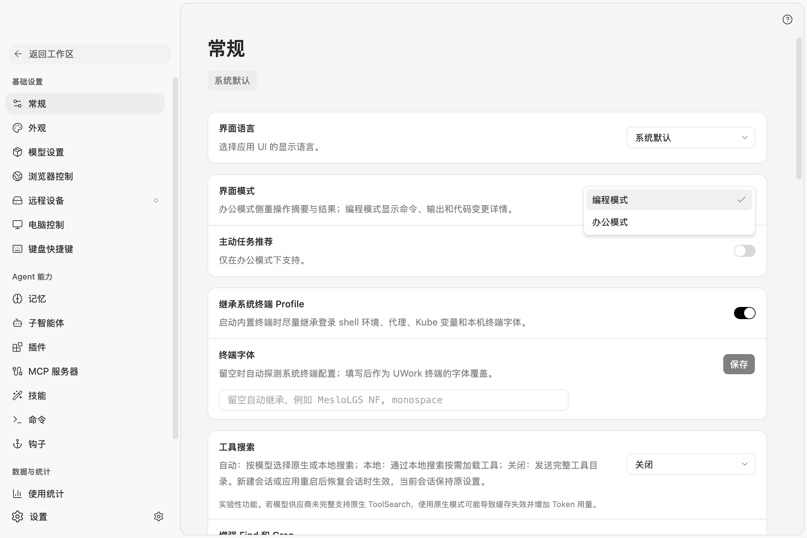

_这是同一项界面模式的另一个入口。下方的“主动任务推荐”仅在办公模式下支持，是否开启可按需要设置。_

### 两种模式有什么区别

| 对比项         | 办公模式                                                 | 编程模式                                                 |
| -------------- | -------------------------------------------------------- | -------------------------------------------------------- |
| 适合的工作     | 整理资料、撰写内容、处理日常办公任务，重点关注交付结果。 | 开发代码、排查错误、运行检查，重点掌握实现细节。         |
| 工作过程展示   | 以操作摘要、任务进度和结果为主，减少命令和代码细节。     | 展示执行命令、输出以及代码变更详情，便于定位问题和审查。 |
| 手动开发入口   | 隐藏新建终端、审查等开发入口，界面更简洁。               | 提供终端、审查等入口，方便手动运行命令、检查差异。       |
| 首页任务入口   | 可使用主动任务推荐，需先开启该功能。                     | 保留报错修复、周报总结等小型场景快捷入口。               |
| 企业模型与插件 | 可按账号与配置使用企业模型、插件等能力。                 | 同样可按账号与配置使用企业模型、插件等能力。             |

**切换界面模式会保留已打开的终端和审查面板。** 需要按本手册第 4 节手动运行检查、审查代码时，先切到编程模式。

界面模式与输入框底部的 **计划模式、变更前确认、自主模式、完全访问** 是两组设置。是否允许修改文件、如何确认命令，仍由执行权限设置决定；切换办公 / 编程模式不会自动更换所选模型或提高执行权限。

### 最简使用流程


**第一次用，从登录开始；已经登录，直接选择项目。每次只完成一个小目标。**

适用版本：**UWork 0.1.0 桌面版**。本文于 **2026 年 10 月 22 日**按已安装的 macOS 版本重新核对并拍摄全部截图。可在登录页底部查看客户端版本；安装包以管理员提供的版本或 [仓库发布页](https://github.com/Jas0nxlee/UWork_frontend/releases)为准。

打开 [离线图文版](index.html) 可放大截图，也可打印或保存为 PDF。

| 你现在想做什么   | 从哪里开始                             |
| ---------------- | -------------------------------------- |
| 第一次打开 UWork | 第 1 节：扫码登录，确认模型可用。      |
| 从零做一个小工具 | 第 2 节：选空文件夹，描述第一版需求。  |
| 修改已有代码     | 第 3 节：选原项目，先了解现状。        |
| 检查结果并接着做 | 第 4、5 节：看差异、跑检查、保存进度。 |

## 1. 第一次使用：企业微信扫码登录

### ① 在电脑上选对公司

打开 UWork，在登录页选择自己所属的公司，再点击 **用对应公司企业微信登录**。

0.1.0 安装包的默认入口包含 **北京、南京、厦门、天津**。公司选项以实际安装包和管理员配置为准；选错公司会影响本次登录使用的企业应用。

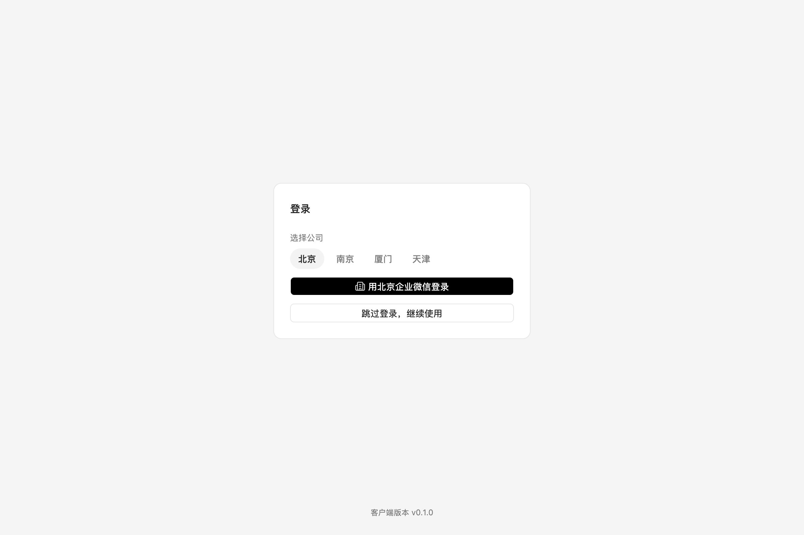

_先核对公司，再核对页面底部的“客户端版本 v0.1.0”。_

### ② 用手机企业微信扫码并确认

1. 点击登录按钮后，等待电脑上的企业微信授权页加载。
2. 如果先出现已有账号的快捷登录页，点击 **切换扫码登录**，显示二维码。
3. 在手机上打开 **企业微信 → 扫一扫**，扫描自己电脑上新生成的二维码。
4. 在手机上核对企业、账号和授权信息，再按提示确认登录。
5. 回到电脑，等待 UWork 完成登录。若出现首次使用引导，可按提示完成；暂不设置可点 **退出引导**。
6. 进入工作区后，检查左上角是否显示自己的姓名；点击姓名，核对所属公司。


_这是实际授权页的局部截图。黑色方块遮盖了本次登录二维码；请扫描自己电脑上的二维码，手册图片不能用于登录。手机确认步骤请按手机上的实际提示完成。_

选错公司时，回到 UWork 点击 **重新选择公司**。二维码过期或加载失败时，返回公司选择页后重新发起登录。

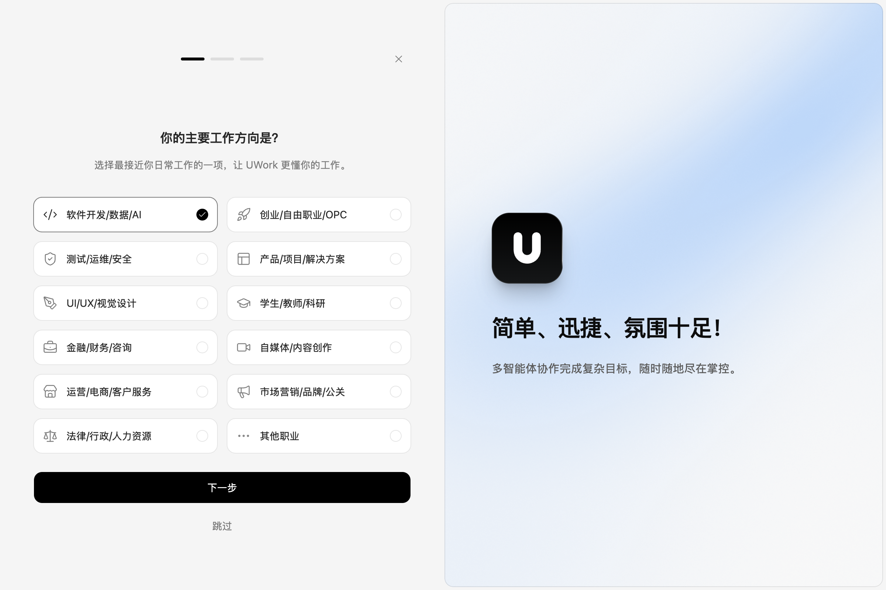

_首次引导用于选择工作方向。退出引导后仍可使用工作区，之后可从“设置 → 引导”重新进入。_

### ③ 确认账号和模型已经准备好

登录后，UWork 会尝试同步企业账号、模型配置、套餐和用量。**看到姓名表示已登录；开始开发前，还要确认输入框底部有可用模型。**

点击左上角姓名，可以找到 **同步企业配置** 和 **企业网关与用量**。

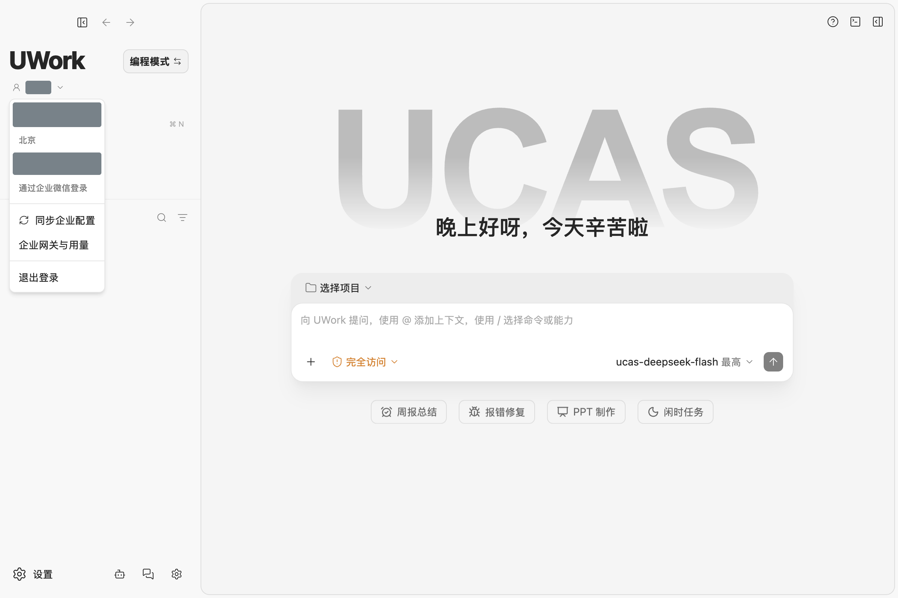

_本图来自真实企业登录后的工作区。姓名、部门等个人信息已遮盖。_

如果模型尚未出现，先点 **同步企业配置**，等待同步完成。仍有提示时，再到 **设置 → 模型设置** 检查模型列表与配置，或联系管理员。

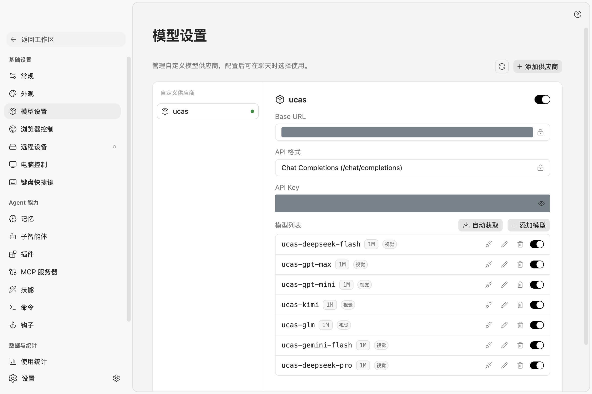

_登录后的实际模型设置。服务地址和密钥区域已遮盖；请勿把密钥发到聊天、截图或项目文档里。_

已有本地 API Key 不会被自动覆盖。只有明确要改用企业密钥时，才在企业网关页点击 **使用企业密钥替换**。同步补充模型不会改写已有模型参数。

首次使用可先发送一句简单问题，确认能正常回复，再开始改代码。模型出现在列表中，不代表账号一定有该模型的调用权限。

### 在哪里查看企业资料、套餐和用量

进入 **姓名菜单 → 企业网关与用量**，也可从 **设置 → 使用统计 → 企业网关** 打开。

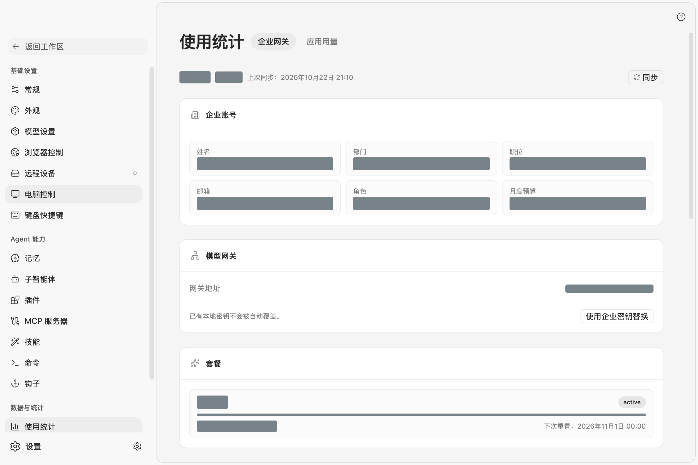

_检查姓名、部门、职位、角色与套餐是否符合预期。灰色区域是脱敏遮盖，实际界面会显示数据。_

| 想了解什么         | 看哪里、怎么操作                                              |
| ------------------ | ------------------------------------------------------------- |
| 账号资料是否正确   | 看“企业账号”；未提供的字段显示“未设置”。有误时联系管理员。    |
| 剩余额度与重置时间 | 看“套餐”中的已用 / 总额度、下次重置时间。                     |
| 最近用了多少       | 在“用量”选近 7 天、本月或近 30 天，再选请求数、费用或 Token。 |
| 当前可用哪些模型   | 看“套餐模型”；需要时点“重新读取”，再将缺失项添加到模型列表。  |

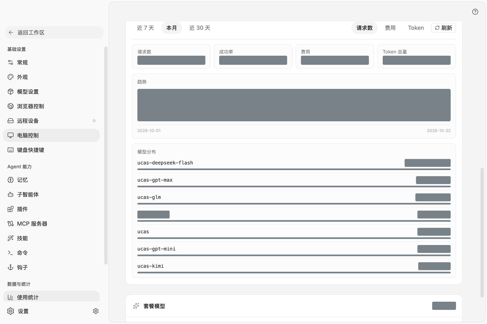

_先选时间范围，再选指标。实际统计值、趋势和分布已遮盖；这些遮盖块不表示零用量。_

数据没更新时，点击顶部 **同步**；只想更新用量时，点击用量区域的 **刷新**。同时查看“上次同步”时间。费用与额度按美元显示，统计来自企业后台，不等于某个项目的独立账单。

如果显示企业会话过期，重新登录后再同步。暂时无法登录时可以 **跳过登录，继续使用**，但需要自行配置模型，且不会自动取得企业资料与企业用量。

## 2. 从零开始：创建第一个项目

### ① 选一个存放代码的文件夹

先在电脑上准备一个空文件夹，例如 `hello-tasks`。

1. 在左侧 **项目** 标题旁点击 **新项目**。也可在输入框上方点 **选择项目 → 创建项目**。
2. 填写项目名称，例如 `hello-tasks`。
3. 设备选择 **此电脑**，点击 **选择文件夹**，选择刚准备的空文件夹。
4. 点击 **创建项目**。若出现信任提示，先核对列出的目录，再点击 **信任文件夹并创建**。
5. 确认输入框上方显示了正确的项目名称。

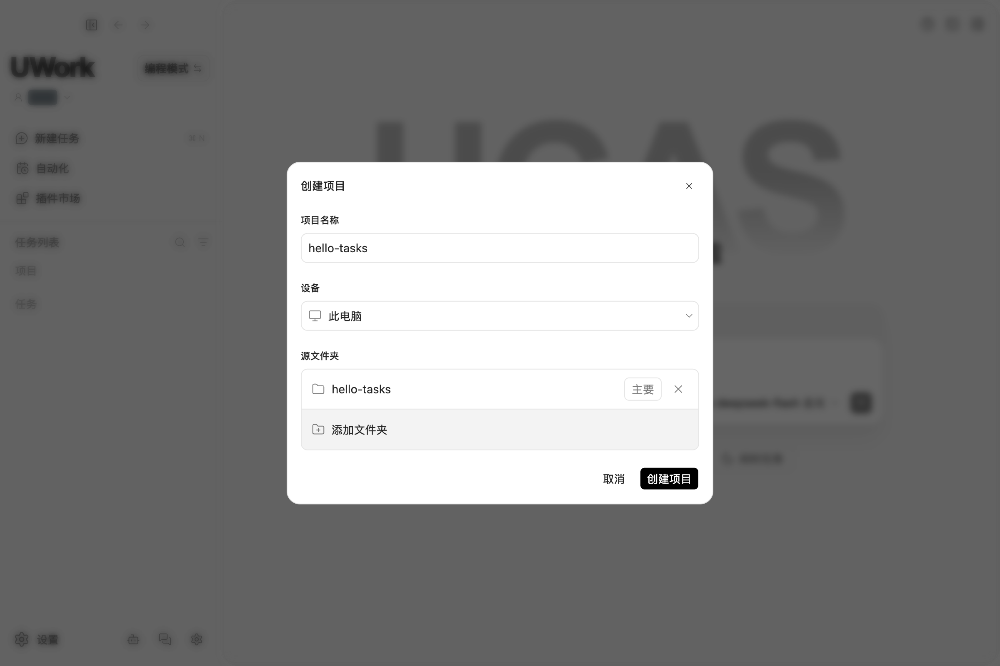

_新项目选择空文件夹；已有项目选择原代码目录。创建项目是把目录加入 UWork，不会凭空生成代码。_

**先分清两个词：项目管理代码目录；任务是一段围绕具体目标展开的对话。** 同一个项目可以有多个任务，新建任务不会自动新建代码文件夹。

### ② 说清第一版要做什么

第一版先做小一些。下面这段可以直接复制：

```text
请在当前 hello-tasks 项目中开发一个待办事项网页。
第一版只做：新增、完成、删除任务，刷新后保留数据。
使用中文界面。请先给出简短方案，确认后再实现。
完成后运行检查，说明如何启动和验收。
```

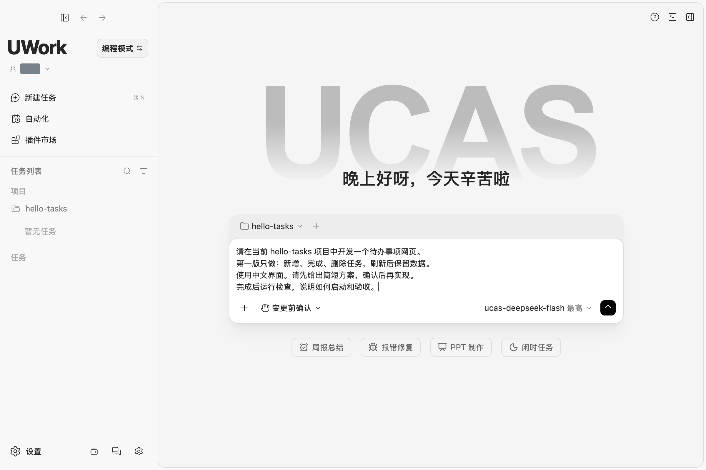

_发送前看三处：上方的项目、下方的权限模式、右下方的模型。截图中的文字是未发送的示例草稿。_

如果项目有指定技术栈，再补一句，例如“沿用 React 和 TypeScript”。不确定时，让 UWork 先给出建议与理由。

### ③ 选合适的权限模式，确认后执行

先按文首的方法切到 **编程模式**，便于查看命令、输出与文件差异。

输入框底部的模式按钮控制执行方式，与左上角的界面模式分别设置：

| 模式       | 什么时候选                                       |
| ---------- | ------------------------------------------------ |
| 计划模式   | 需求还没定，先看计划再决定实施。                 |
| 变更前确认 | 希望修改文件前先确认，适合刚接手项目。           |
| 自主模式   | 目标与范围明确，希望遇到风险时再询问。           |
| 完全访问   | 减少确认次数；使用前先明确目录、任务范围和风险。 |

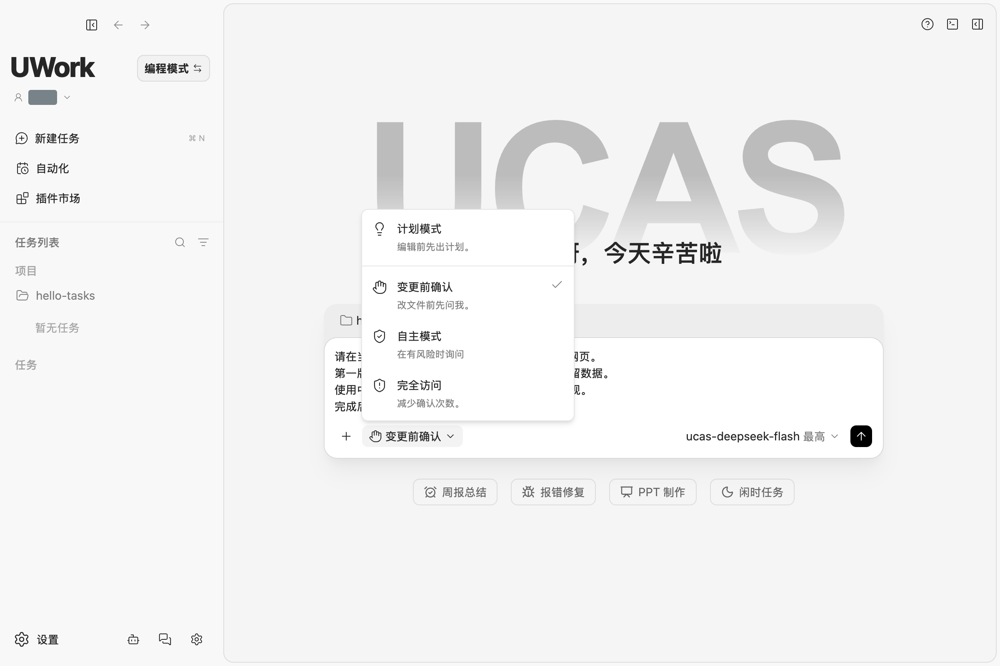

_初次使用可从“计划模式”或“变更前确认”开始。_

点击输入框右下角的 **发送箭头**。方案合适后，再明确告诉 UWork 开始实现：

```text
按这个方案实现第一版。完成后列出修改的文件、实际运行的检查和启动步骤。
如果缺少依赖或运行环境，请明确说明缺什么。
```

遇到确认提示时，先读清涉及的文件和命令。完成后按第 4 节检查结果。

## 3. 接手已有项目：先了解，再修改

### 打开原来的代码目录

同样点击 **新项目 → 选择文件夹**，选已有代码的根目录并创建项目。通常应选择包含 `README`、`package.json`、`pyproject.toml` 或其他项目配置的那一层。

代码还在 Git 仓库中时，先克隆到本机，再选择克隆后的目录。打开项目不会自动拉取远端最新代码；多人协作时，先检查未提交改动，再按团队流程同步分支。

已有项目已出现在左侧时，在输入框上方通过 **选择项目** 选中它。远程工作区还要核对设备与连接，不能只看目录名称。

### 先发一条“只阅读”的需求

```text
请先阅读 README、项目配置和主要源码，暂时不要修改代码。
说明项目做什么、如何启动与测试，以及本次需求相关的代码位置。
检查 Git 状态，保留已有改动。
```

将鼠标移到左侧项目名上，点击 **查看文件**，在右侧浏览目录。点击文件查看内容，先读项目自己的 README。

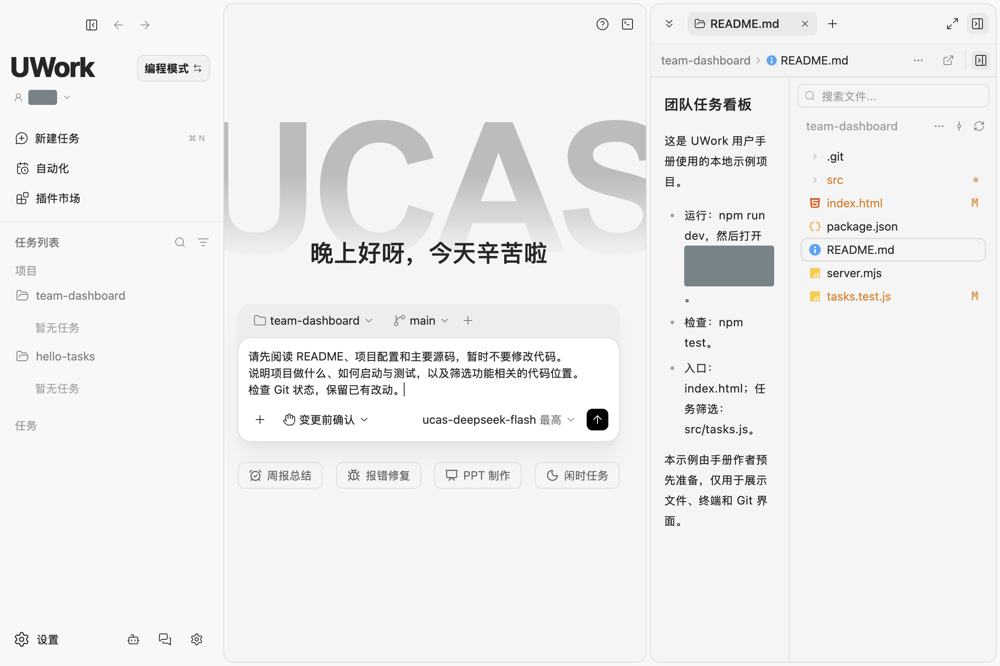

_左侧选项目，中间说明目标，右侧查看文件。截图中的需求仍是未发送草稿。_

### 每次只推进一个明确目标

例如：

```text
给 team-dashboard 增加“未完成”筛选入口，复用现有筛选函数。
保留已有改动，不改存储方式，也不调整其他页面。
完成后运行相关测试，实际检查筛选交互，并汇总结果。
```

描述需求时补齐 **目标、范围、验收方法**。报错时附上复现步骤、预期结果、实际结果和关键错误。需要文件或图片时，使用输入框的 **＋ / 添加上下文**，也可输入 `@` 选择上下文。

## 4. 开发完成后：看差异、跑检查、试效果

### ① 看差异：有没有改错或多改

点击右上角 **展开侧边面板**，选择 **审查**；右侧已打开标签时，点标签栏 **＋ → 审查**。

选择 **未暂存** 等对应范围，展开文件查看差异。检查修改是否符合需求，有没有误删内容、混入别人的改动。绿色通常表示新增，红色表示删除。

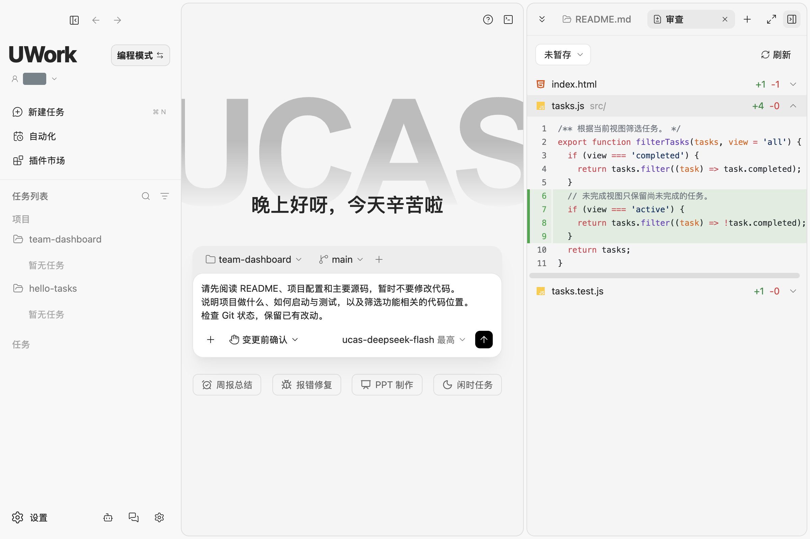

_这个本地示例包含页面入口、筛选逻辑和测试三处改动，由手册作者准备，用于演示审查操作。_

### ② 跑检查：确认真的执行并通过

点击工作区右上角 **切换终端**，按项目 README 或配置文件中的命令运行检查。也可以要求 UWork 执行，并汇总通过、失败和未执行的项目。

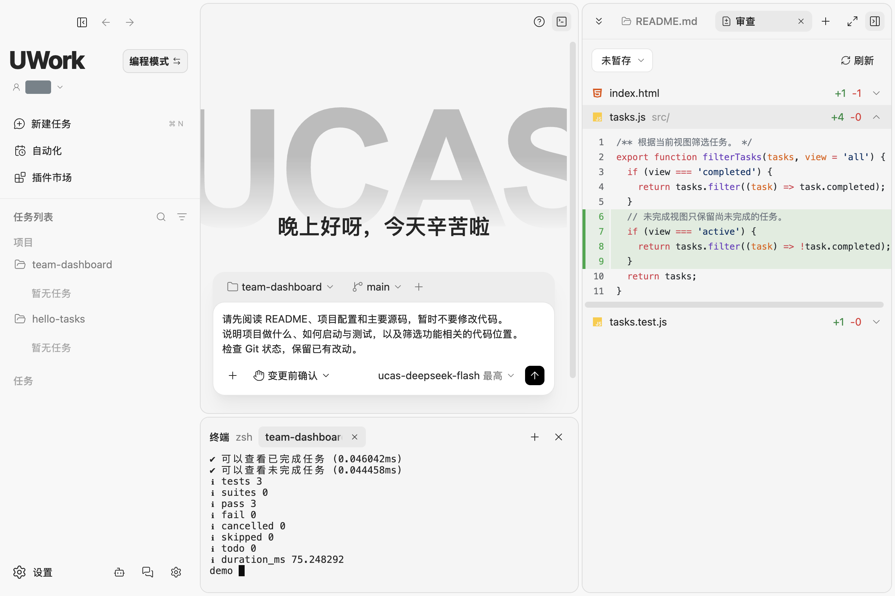

_本次实际执行 `npm test`，示例的 3 项测试通过、0 项失败。这只是示例项目的结果，不代表 UWork 自身的测试数量。_

不同项目的检查命令不同，不必照搬截图。测试失败时，先看具体命令和错误，再定位原因。

### ③ 试效果：亲手走一遍关键操作

按项目说明启动服务。点右侧标签栏 **＋ → 浏览器**，输入终端给出的本地网址；也可在系统浏览器访问。预览期间需保持开发服务运行。

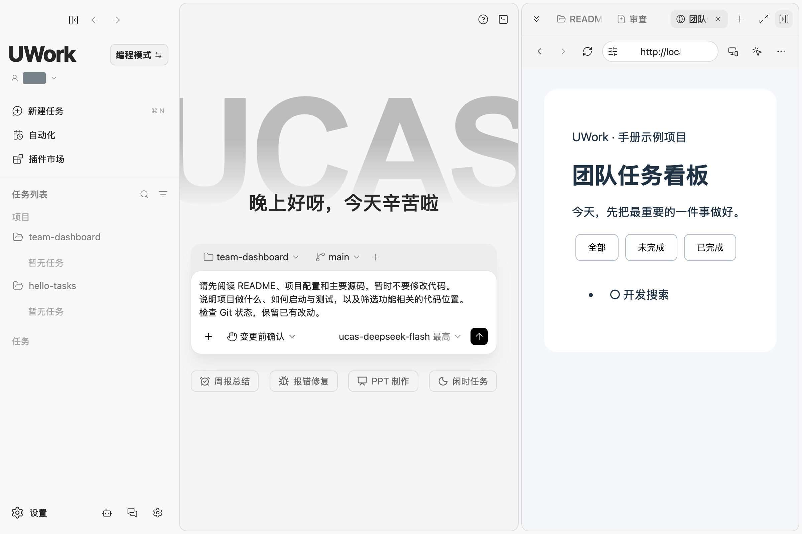

_本次启动了本地示例服务，并实际点击“未完成”检查筛选结果。页面与代码均由作者准备，不是一次 AI 自动开发结果的记录。_

按这次需求逐项验收。例如待办网页应试一遍新增、完成、删除，再刷新确认数据是否保留。**看到了页面，不等于功能都验收完成。**

## 5. 保存进度，下次接着做

**同一件事继续修改，就打开原任务；新的功能或独立问题，在同一项目下新建任务。** 可使用左侧项目旁的 **新建任务**，或主界面的新建任务入口，并确认输入框上方的项目。

结束前，让 UWork 留一份简短交接：

```text
请总结本次完成了什么、修改了哪些文件、哪些检查已通过、还剩什么。
把下次需要的背景写到项目文档中，方便继续。
```

使用 Git 的项目，验收后保存一次小而清晰的提交：

```text
先检查 Git 差异，只提交这次任务相关的文件，不包含原有的无关改动。
提交后告诉我提交编号，暂时不要推送。
```

本地提交与推送到远端是两步；要同步给同事时，再核对远端与分支并推送。对话记录不能替代 Git 版本记录。

下次打开原任务后，可以这样继续：

```text
先核对当前文件、Git 状态和上次记录，再说明下一步。
今天只处理约定的小目标，不扩展其他功能。
```

## 6. 其他常用入口与版本边界

| 你想做什么         | 入口与说明                                                                                                                   |
| ------------------ | ---------------------------------------------------------------------------------------------------------------------------- |
| 切换信息展示       | 左上角“编程模式 / 办公模式”。不会替代输入框底部的权限设置。                                                                  |
| 扩展工具能力       | 左侧“插件市场”，公司专有插件见第 7 节；也可从设置进入插件、MCP 服务器、技能等配置。                                          |
| 管理机器人通道     | 点击侧栏底部的机器人图标，打开“机器人”窗口。                                                                                 |
| 打开 Office 文件   | 在文件面板打开 Word、Excel 或 PPT。是否允许编辑由格式、大小和内容护栏决定，复杂文件可能只读。                                |
| 使用 Word 修订审阅 | `office-editor` 提供修订、批注与审阅入口；未配置外部引擎时是只读预览。见 [插件说明](../../plugins/office-editor/README.md)。 |
| 在远程设备上开发   | 使用远程工作区 / Source Server；操作前同时核对连接的设备和项目目录。                                                         |

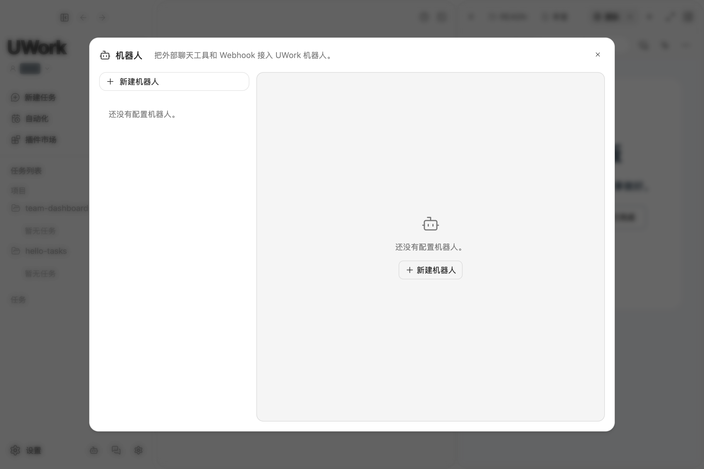

_入口已从旧的远控弹层迁到侧栏底部。本图仅展示入口，不表示已经配置或验证了消息收发。_

**0.1.0 已移除手机 / 浏览器远控客户端及配对入口。** 远程工作区仍然保留；用电脑连接远程项目，与用手机远控桌面是两种不同操作。Office 能打开文件，也不代表任意复杂文档都可以完整编辑。

## 7. 公司插件市场：查找公司专有插件

**公司会在插件市场的“公司”分区统一发布公司专有插件。** 这里是查找公司内部专用能力的入口；后续有新的公司插件发布时，可优先到这里查看。

### 怎么进入

1. 点击左侧 **插件市场**。
2. 在市场顶部的来源分区中点击 **公司**，进入公司插件市场。
3. 浏览列表，或在当前分区内搜索插件名称。点击插件卡片，查看用途、使用说明和安装状态。
4. 需要使用时，按页面提示 **安装**，并完成插件要求的配置；再按插件说明，在任务中调用相关能力或打开插件提供的页面。

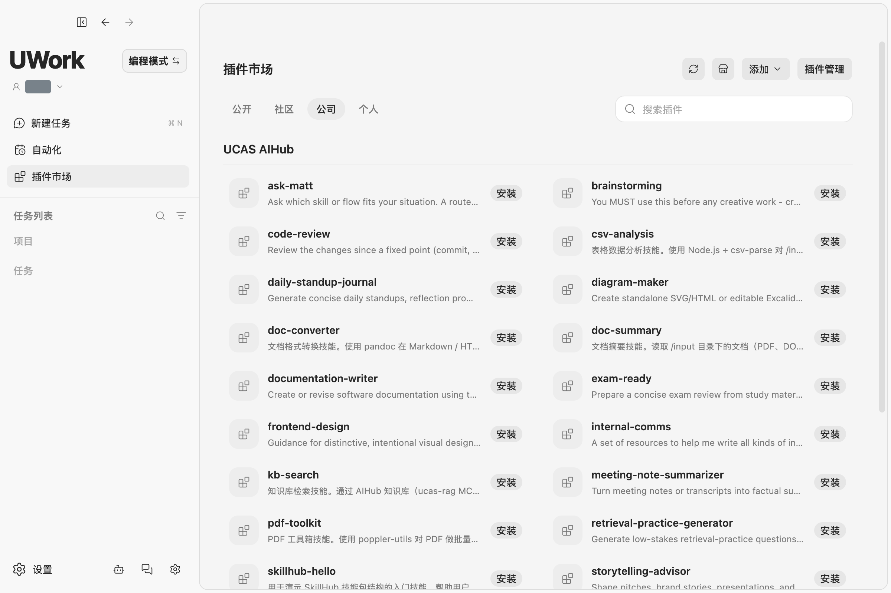

_点击顶部“公司”，可浏览公司配置的 UCAS AIHub 市场。图中是拍摄时的实际目录；公司后续会在这里统一发布专有插件。_

### 安装后在哪里管理

在插件市场右上角点击 **插件管理**，查看已安装的插件，并按需要配置、启用或更新。公司插件的具体功能和使用方法，以该插件的说明及公司发布通知为准。

公司插件会陆续发布，当前能看到哪些内容以实际列表为准。没有看到新插件时，先点击右上角 **刷新**；仍未出现，可联系管理员确认发布情况和服务连接。

## 8. 遇到问题，按这张表排查

| 遇到的情况                 | 先做什么                                                                             |
| -------------------------- | ------------------------------------------------------------------------------------ |
| 找不到自己的公司           | 核对安装版与管理员配置，联系管理员确认正确入口，不随意选另一家公司。                 |
| 扫码后没有进入工作区       | 检查手机是否已确认、企业与账号是否匹配；二维码过期时重新发起登录。保留具体错误提示。 |
| 登录后没有可用模型         | 姓名菜单中点“同步企业配置”，再检查模型设置与账号权限。                               |
| 账号有姓名，但用量同步失败 | 看错误和上次同步时间；会话过期时重新登录。空白或失败不代表零用量。                   |
| 找不到文件或改错项目       | 核对输入框上方的项目，用“查看文件”确认目录。                                         |
| 一直在等待                 | 检查是否等待计划确认、权限确认或补充信息，再看具体错误。                             |
| 页面打不开                 | 确认开发服务还在运行，网址和端口与终端输出一致。                                     |
| 测试失败                   | 提供实际执行的命令与错误，区分环境问题和本次改动引起的问题。                         |

**每完成一个小目标，就看一次差异、跑一次相关检查、试一次关键操作，再保存进度。**

---

截图与验证说明：全部 19 张截图均于 2026 年 10 月 22 日从已安装的 UWork 0.1.0 macOS Apple Silicon 版本重新拍摄，没有复用旧版本图片。工作区、账号和用量页来自实际企业认证后的客户端；为保留当前会话，扫码授权页使用同一安装版的临时登录窗口单独拍摄，展示真实生成的授权页，二维码已遮盖，拍摄后取消该次登录。手机确认步骤未拍摄，不把该临时窗口当作完整扫码回调验收。姓名、部门、密钥、服务地址及企业统计已脱敏。两个示例项目由作者准备，所有聊天输入均为未发送草稿；实际执行了示例测试和页面筛选操作，本次未发送模型请求。模式切换按钮、设置菜单和公司市场列表也使用安装版实拍；未安装或启停市场插件，拍摄后恢复了原界面模式与页面。逐图尺寸、版本、来源与 SHA-256 见 [截图清单](capture-manifest.json)。
