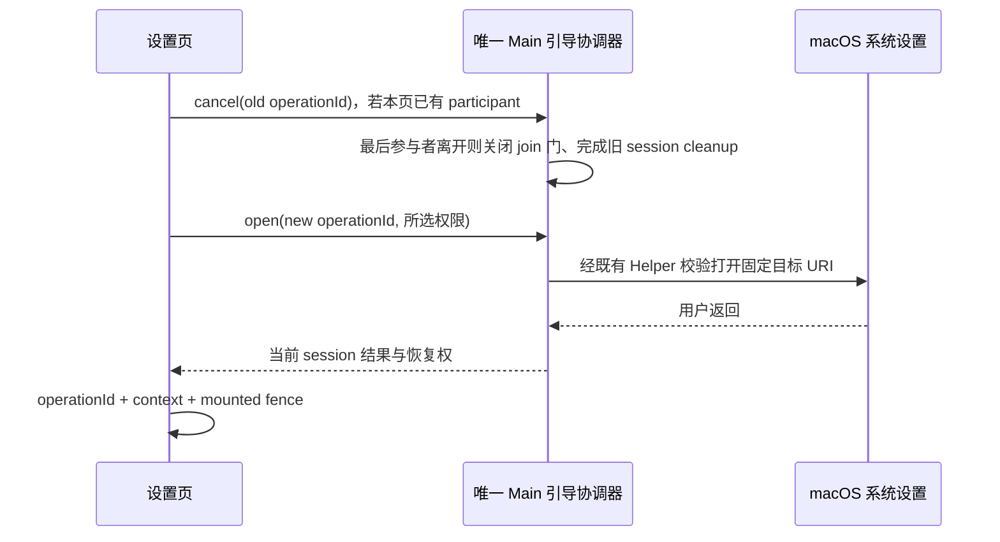

# 电脑控制设置的显式系统面板入口

## 已确认问题

`ComputerUseSection` 把用户点击「打开辅助功能设置 / 打开屏幕录制设置」错误地当成自动补权请求：先读取 Helper 状态，状态已授权或不可用时直接返回；检查期间及现有引导未完成时也会静默丢弃点击。状态展示与导航意图因此互相阻塞。

Main 的引导协调器本身不按权限快照裁掉 stage；收到精确权限请求后才通过现有安装/验签、面板打开、返回恢复链。不能把 Launcher/直接执行进程读到的不同 TCC 结果混作同一授权主体的证据。

## 产品规则与所有者

- 设置页的显式打开按钮始终保留，已授权、未授权、未知和查询中都可以打开用户选定的 macOS 面板。状态只用于展示，不作为导航前置条件。
- Renderer 不额外调用 `getStatus`，不等待权限查询、不添加重试/延时，也不从功能探针失败推断系统缺权。
- Main 继续是唯一 native 引导、Helper 来源验证、会话清理和返回恢复 owner。权限类型只通过现有平台服务及固定 Main URI 路由传递，Renderer 不直接操作系统或 Repo。
- 同一设置页已有 participant 时，新点击先通过现有 `cancelCuaPermissionOnboarding(operationId)` 退出旧 participant，再发送新的精确权限请求。沿用 operationId、workspace/context、挂载生命周期与 recovery claim 的晚回防护；旧调用成功或失败的迟到结果不能恢复新请求的 Helper 或显示错误。
- Main 最后一个 participant 取消时同步关闭 join 门并取消旧 session；新的请求等该 session 清理完再开始，不能 join 已取消的 native stage。不创建第二个授权状态 owner。
- 用户切换 workspace 或离开设置时，仍取消本页的 participant，不更改其他窗口或运行任务的业务状态。
- 已授权状态保留导航按钮；辅助功能 stale 状态同时保留原重启操作和打开面板入口。
- 正式签名校验与明确的本地开发构建边界不变。

## 验收

1. 页面旧显示未授权，而点击时可读状态已授权：精确目标面板仍打开，点击不发起 `getStatus`。
2. 权限检查没有完成或不可用：打开按钮仍可用，不等待检查完成。
3. 两项均已授权时，两个精确面板入口仍存在并可点击。
4. 辅助功能引导尚未返回时点击屏幕录制：取消旧 operationId 后发起新请求；旧调用晚成功不触发恢复。
5. 离开设置/切换 workspace 的取消与晚回隔离继续成立。
6. 桌面 E2E 覆盖连续切换两按钮，断言 Main 的精确 URI、旧面板清理以及没有状态未知 toast；真机另核实际系统设置可见面板，不能把 mock 外跳当作系统授权已完成。
