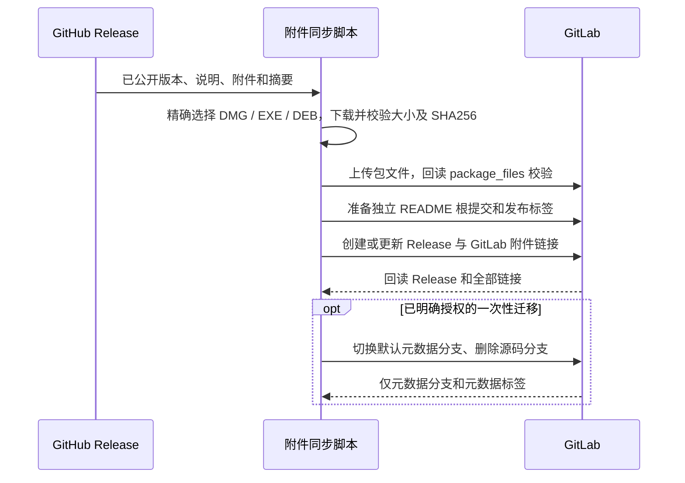

# UWork GitLab Release 手动附件工具

## 生命周期

2026-10-24 按用户要求移除 GitLab 同步 workflow 及桌面发布派发入口，后续 GitHub Release 不再自动写入 GitLab。保留手动脚本及其测试，用于显式人工调用；不删除已有远端发布、包或配置。下述附件合同仅适用于保留的手动工具。

## 产品规则

- GitHub Release 是版本、说明、附件和 SHA-256 的事实来源。GitLab 仅用于分发发布附件，不同步应用源码、源码标签或源码分支。
- 手动工具只校验并上传三个安装文件：`UWork-<版本>-mac-arm64.dmg`、`UWork-<版本>-win-x64.exe`、`UWork-<版本>-linux-amd64.deb`（Ubuntu x64 使用 Linux amd64 DEB 产物）。上传到 GitLab Generic Package Registry 的 `uwork-release/<版本>/` 后创建或更新同名 Release。取消可选 upload_assets 和 force_branch 入口，不能退化为 GitHub 下载链接。
- 选择规则由同步脚本的单一函数拥有，调用方下载和脚本校验/上传/建链接须使用同一名单。三个文件各须恰有一个；缺失或重复在任何写入前失败，不回退到 ZIP 或其它安装格式。忽略 ZIP、macOS x64、Linux ARM64、RPM、AppImage、清单及审计附件；GitHub 完整发布仍保留原五平台门禁和全部格式。历史 GitLab Release/包/手工链接不自动删除。
- GitLab Release 必须关联 Git 标签；所有发布标签关联独立的 `release-metadata` 根提交。该提交只有固定 README.md、无父提交，与 GitHub 源码历史无关。实际源码 SHA 保留在发布 manifest 中。
- Release 附件链接指向 GitLab 包文件；允许额外保留一个 GitHub Release 来源页面链接。按名称更新链接，分页读取全部现有链接（本次共 21 条，超过 API 默认的 20 条）。以实际包 URL 和链接类型判定一致性，不依赖目标未返回的自定义 direct_asset_path 字段；重复运行不新增重复包文件或链接，不改写已一致的链接。
- 上传前校验所有本地附件（文件名、大小、GitHub digest）；上传后读取 GitLab package_files 的大小和 file_sha256 逐项比对。已有同版本包只有内容一致才能视为成功；冲突失败，不覆盖已发布文件。
- 正常发布不得删除分支、移动既有标签。遇到已有源码标签必须提示显式迁移。

## 一次性源码清理

- 用户于 2026-10-22 明确要求清理 GitLab 源码，保留打包内容并改为 Release 发布。环境参数 CLEANUP_SOURCE 仅用于这次迁移，默认关闭。
- 先以 inspect 模式读取项目、所有分支、标签和 Release；保留引用 SHA 及 Release 元数据审计记录，不打印凭据或源码。
- 迁移先上传并校验全部附件，再准备独立元数据提交。只允许重建本次 Release 的旧源码标签；发现其它源码标签或其它 Release 时停止，先调查，不隐式删除。
- 旧标签迁移可能删除对应 GitLab Release，因此保留说明和附件清单并重新创建同版本 Release。GitHub 标签与 Release 不做任何改写。
- Release 完整落地并回读成功后，将默认分支改为 release-metadata，再通过 API 删除其余源码分支；受保护分支只移除对应精确保护规则，删除失败时恢复保护，通配规则停止并调查；按初始清单检查 SHA，出现并发更新停止。清理后回读所有分支/标签，必须只剩元数据引用。
- 清理指移除用户可达的源码引用；服务端不可达对象回收由 GitLab 管理，不声称完成物理擦除。

## 所有者、接口和顺序

同步脚本唯一负责 GitLab 写入，仅允许人工显式调用；创建元数据提交使用全新临时 Git 仓库，不读取当前源码 Git 对象。令牌使用 GITLAB_TOKEN，具有 api 及创建独立元数据引用的 write_repository 权限。网络和文件 IO 使用异步接口。调用方须串行执行，避免元数据分支初始化及迁移竞态。

## 验收场景

1. 手动同步只上传 macOS ARM64 DMG、Windows x64 EXE、Linux/Ubuntu x64 DEB，GitLab 下载链接指向本机包注册表，大小与摘要和 GitHub 一致；缺失、重复目标或损坏文件阻止发布。即使 ZIP 齐全，也不能替代缺失的安装文件；其它架构、格式和版本不能混入。
2. 发布后 GitLab 标签只引用单 README、无父提交的元数据根，源码提交不被推送。
3. 同版本重跑幂等；本地附件缺失/摘要错误、远端摘要冲突、令牌无效、网络不可达时失败，不输出成功。
4. 普通重跑拒绝旧源码标签；显式迁移在附件完整后重建标签及 Release，删除源码分支；未知其它标签/Release 或引用并发变化时停止。
5. inspect 模式只读；测试覆盖包文件验证、标签隔离、清理保护和自动入口已移除的合同。验证运行 node --test scripts/test/gitlab-release-\*.test.mjs，加根 typecheck、lint、架构检查。
