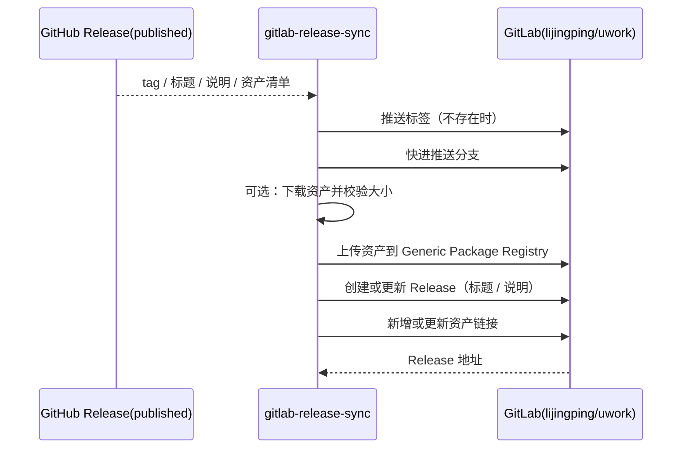

# UWork GitHub Release 同步到 GitLab

## 同步规则

- 触发条件：GitHub 侧 `release` 事件的 `published` 动作，以及手工 `workflow_dispatch`（可选指定 tag、是否上传资产、是否强制更新分支）。
- 同步目标固定为 `http://g.ucas.com.cn:8088/lijingping/uwork`，可用仓库变量覆盖；路径、分支和开关不写进提交的脚本常量以外的地方。
- 一次同步交付四类内容：创建 Release 的 Git 标签、更新目标分支、创建或更新 GitLab Release（标题与说明取自 GitHub Release）、创建资产链接。启用 `upload_assets` 时，先上传资产文件再写链接。
- GitLab 是只写对端：同步过程不删除分支、标签、Release 与既有链接，也不改写 GitHub 侧数据。标签不可变，GitLab 上同名标签指向其它提交时立即失败，不移动标签。
- 目标分支默认快进推送。非快进（GitLab 分支领先或历史无关）时失败并保留其它已完成的同步结果，手工确认后可用 `force_branch` 以 `--force-with-lease` 覆盖。
- 重复执行必须幂等：标签已存在且指向同一对象时跳过推送；Release 已存在时改用更新接口；链接按名称对比，允许新增与更新，不删除其它链接。
- 资产上传使用 GitLab Generic Package Registry，包名 `uwork-release`，版本取标签去掉前导 `v`。上传前逐个比对本地文件大小与 GitHub Release 元数据，不一致立即失败；已存在的包文件先用 `GET` 探测状态码（不下载内容），命中即跳过重复上传。
- `workflow_dispatch` 未指定 tag 时取最新已发布 Release；草稿（`draft`）不同步。
- 手工派发只用于重跑同一版本的同步，不用于跨版本回填；历史版本回填由发布负责人逐个人工执行。

## 凭据与可达性

- 只读取 `GITLAB_TOKEN` secret：项目访问令牌或个人访问令牌，需同时具备 `api`（创建 Release、上传包）与 `write_repository`（推送 Git 引用）。
- 令牌只通过环境变量进入脚本；Git 推送使用临时凭据文件，推送 URL 与命令参数中不出现令牌，脚本和日志不打印令牌内容。
- `g.ucas.com.cn` 校内解析为内网地址 `10.1.180.113`，公网解析为 `114.255.110.138`。托管 runner 只能走公网入口；公网入口不可用时通过仓库变量指定可访问该校内地址的自托管 runner，不用超时重试掩盖不可达。
- 网络不可达、令牌无效、无权限、标签冲突、资产校验失败都直接失败并输出原因，不降级为“部分成功”的静默通过。

## 所有者和事件顺序

- GitHub 的 `publish` job 是 Release 的唯一创建者；本工作流是下游消费者，只读取 GitHub Release，不创建、不修改、不公开 Release，也不依赖发布流水线的中间产物。
- 同步工作流唯一拥有 GitLab 侧的写入：标签、分支、Release、资产链接和包文件。
- 工作流检出默认分支以获得最新同步脚本，标签通过 `fetch-tags` 取回；分支推送使用标签对应的提交，不使用检出点，避免把标签之后的提交带到 GitLab。
- 手工 `upload_assets`、`force_branch` 输入优先于仓库变量；仓库变量优先于脚本默认值。
- 同步在 GitLab 全部成功后输出 Release 地址；任一阶段失败都返回非零退出码，后续阶段不再执行。

## 验收

1. 发布新 Release 后工作流自动运行，GitLab 上出现同一标签的 Release，标题与说明和 GitHub 一致。
2. 同一标签重复运行不报错、不重复创建标签或 Release，链接未变化时不产生多余写请求。
3. GitLab 已有标签指向其它提交、Release 为草稿、`GITLAB_TOKEN` 缺失或权限不足时，工作流在对应阶段失败且错误信息指出原因。
4. 目标分支非快进时默认失败，使用 `force_branch` 后按 `--force-with-lease` 更新，GitLab 上其它分支与标签不受影响。
5. `upload_assets` 关闭时只写链接，指向 GitHub 资产地址；开启时资产文件进入 GitLab 包注册表，链接指向 GitLab 包地址，且不会同时保留两套链接。
6. 脚本与工作流契约由 `scripts/test/gitlab-release-sync.test.mjs` 覆盖，工作流在同步前执行该测试。
