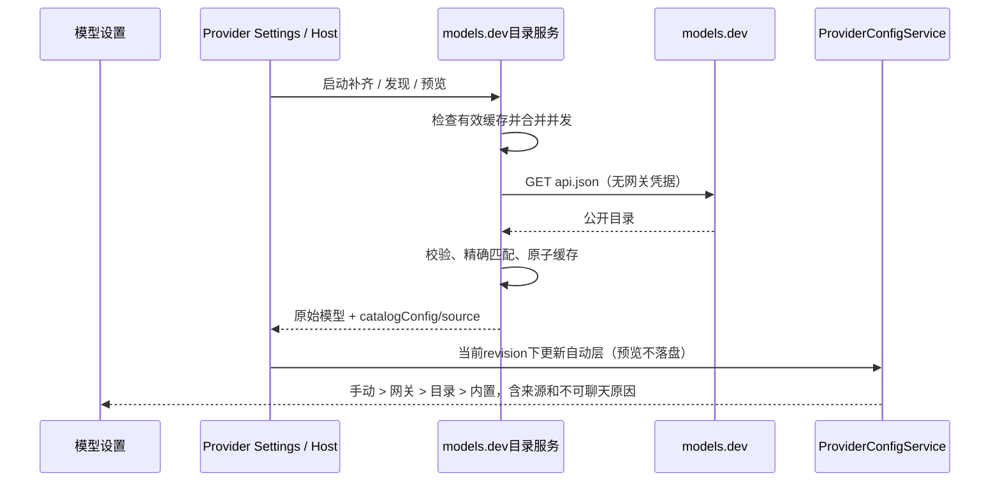

# models.dev 模型能力目录

## 产品规则

本功能在模型设置中自动补齐模型的上下文、最大输出、输入类型和明确的推理档位。按用户最新指定，字段优先级为：个人普通/固定覆盖 > 网关明确下发参数 > models.dev 目录 > 软件内置型号推荐/通用默认值。目录是型号推荐，不宣称为网关实测结果。2026-11-04 用户最新确认：自动参数按网关 > models.dev > 内置逐字段合并，个人覆盖仍最高。网关未提供的字段从目录补齐，目录无匹配或不可用时使用软件内置型号/通用默认。启动刷新只更新目录层，不清空网关层。

- 固定从 `https://models.dev/api.json` 获取公开目录，匹配在本机进行，不发送网关密钥、请求头、模型列表、工作区或任务内容。
- 首次 Host 就绪后后台补齐已保存模型；模型设置刷新、自动获取和新增/改名时的推荐预览共用该目录。启动补齐不请求供应商的模型列表，不阻塞窗口启动。
- 精确匹配实际端点与目录模型优先；普通标准型号可使用自指 canonical 的原厂记录。原厂条目缺失时，只有至少两个供应商记录具有完全相同的显式 canonical_model_id（尾部等于请求 ID）且白名单能力数据完全一致才可采用该共识；单个转售商或能力冲突仍未匹配。不可随机挑选转售商，不能根据部分字符串、相近版本或 `ucas-*` 等逻辑别名猜测真实型号。保留原始请求 ID。
- `limit.context` 是上下文，`limit.output` 是最大输出；只保存正整数，0 不表示无限。`modalities.input` 的 text/image/audio/video/pdf 与对应 MIME 类型映射为输入支持位；不把协议类型当输入类型。缺失字段保持未知，不将缺失推断为 false。
- `modalities.output` 明确不含 text，或 input 明确不含 text 时标记不适用于当前聊天入口；仍显示模型和能力，不进入聊天模型选择，也不能发起聊天连通性测试。不引入图片生成/语音执行引擎。
- 仅明确的 `reasoning_options` effort 数组写离散档位，按语义排序。`reasoning=false` 明确关闭推理。只有 boolean=true、budget_tokens 或无法映射的 toggle 时，不制造 low/high/max。保持现有可确认的型号请求映射；协议回退映射只能用于明确 effort，不执行目录传来的程序或请求模板。
- 所有输入模态（含 audio）可显示并保留手动覆盖。Text 锁定控件反映真实值，不强行显示 true。音频能力是模型元数据，本次不新增客户端音频附件发送能力，设置页明确说明。
- 非聊天模型不伪造正上下文来满足聊天合同，显示原因；编辑器不保存无效 0，仍保留原有完整性校验。

## 状态所有者与接口

`services/model-catalog` 为 managed 模块，唯一拥有当前进程目录缓存、网络刷新和并发去重。ProviderConfigService 继续唯一拥有成员、自动能力与用户覆盖；UI 不直接联网、不另存可执行配置。

目录模块公开 `createModelsDevCatalog({request, cachePath?, now?, ttlMs?}).enrich({apiType,baseUrl}, models)`，返回扩展的 `DiscoveredModelInput[]`；目录适配器只附加目录数据；Host 保留网关 config，并通过 Facade 保存独立目录层，不改个人配置。

Provider 自动规则增加可选 `catalogConfig` / `catalogSource`，分别保存目录配置及 `source=models.dev`、providerId、modelId、canonicalModelId（可选）、fetchedAt、stale。两者成对持久化。旧文件缺少目录字段继续有效。

- 输入 `catalogConfig=undefined`：本次未取得目录结论，保留同端点已有目录值。
- 输入 `catalogConfig=null`：成功查询但没有匹配，清除该身份旧目录推荐；用户值不受影响，自动层回到内置兜底。
- 输入 `catalogConfig=object`：替换目录层，不物化为个人覆盖。
- `preserveCapabilities=true` 保留已有网关层并只更新目录；启动补齐使用此模式。
- 自动数据仍绑定 apiType/baseUrl。连接、ID、用户编辑代次或Registry revision变化，拒绝旧结果；目录更新不复活被删除的模型，不改变启停或顺序。
- Settings/Resolution 提供 `capabilitySource=catalog` 和 catalogSource；非聊天通过派生 `unsupportedReason=non-chat-model` 表达，不增加第二份可变执行状态。

## 缓存与失败

12 MiB 解码响应预算、15 秒网络超时、24 小时新鲜期、失败后 5 分钟再试。并发调用合并；只在完整校验成功后原子替换最后一次有效快照。磁盘缓存使用版本化、轻量白名单数据，不保存价格、描述、密钥或远端代码。损坏缓存和错误响应不得污染已有推荐。

网络不可用时使用最后一次有效目录并标明缓存来源；无可用目录时保留网关/用户配置及上次推荐，不因外部目录失败阻止模型列表获取。刷新结果不得在Host dispose后提交。多窗口文件写入继续走现有锁和revision合同。

## 验收

1. 标准ID准确获取不同上下文、输入支持与effort；相似/未知/冲突ID不误匹配，原始请求ID不变。
2. 网关优先于目录，目录优先于内置；缺失字段逐层补齐，没有匹配时内置上下文/推理仍可用；手动上下文、image/audio/video/pdf和推理档位优先且重启保留。
3. 启动补齐已有模型，无须重新添加；发现和预览使用同一服务，预览不修改成员或配置。
4. 网络失败、损坏缓存、无匹配、过期revision、删除、切换端点和Host销毁不覆盖错误身份或丢配置。
5. image-only等非聊天模型仍可查看，聊天选择/探测禁用；0不成为有效上下文，缺失字段不推断支持。
6. Electron E2E以隔离目录种入受控缓存，不依赖公共目录当时内容；覆盖input/audio、目录优先、手动覆盖、重启和非聊天。
7. Node 24.14.0下执行类型、Lint、架构及定向测试；最后构建macOS arm64本地开发版、备份并替换应用，验证真实spacebus配置和连通性。

## 依据

- https://github.com/anomalyco/models.dev#api-reference
- https://github.com/anomalyco/models.dev#adding-a-new-provider-model
- https://models.dev/api.json

## UCAS 离线内置映射（用户指定，2026-11-04）

用户明确确认以下逻辑 ID 对应真实型号，允许仅对这些精确 ID 建立内置能力规则，不改请求中的原始 ID。获取公开目录中对应型号的上下文、输入/输出模态和推理配置，固定快照随软件分发，离线仍可使用。请求映射遵循 UCAS 的 OpenAI Chat Completions 协议；内置值低于网关与目录。

| UCAS ID             | 用户指定型号        |
| ------------------- | ------------------- |
| ucas-gpt-max        | Claude-5-5-Sonnet   |
| ucas-kimi           | Kimi-K3.1-Pro       |
| ucas-glm            | GLM-5.3             |
| ucas-deepseek-flash | DeepSeek-Flash-1017 |
| ucas-deepseek-pro   | DeepSeek-Flash-1017 |
| ucas-gpt-mini       | Claude-5-5-Haiku    |

测试覆盖六个精确别名的离线解析、网关/目录/手动逐字段优先级，以及原始请求 ID 不变。

### 内置数据快照

2026-11-04 从 `https://models.dev/api.json` 的原厂记录提取：

| 内置别名                                | 原厂 canonical                    | 上下文 / 最大输出 | 输入             | effort                    |
| --------------------------------------- | --------------------------------- | ----------------- | ---------------- | ------------------------- |
| ucas-gpt-max                            | anthropic/claude-sonnet-5-5       | 1000000 / 128000  | text,image,pdf   | low,medium,high,xhigh,max |
| ucas-gpt-mini                           | anthropic/claude-haiku-5-5        | 1000000 / 128000  | text,image,pdf   | low,medium,high,xhigh,max |
| ucas-kimi                               | moonshotai/kimi-k3.1-pro          | 1048576 / 1048576 | text,image,video | low,high,max              |
| ucas-glm                                | zhipuai/glm-5.3                   | 1000000 / 131072  | text             | low,high,max              |
| ucas-deepseek-flash / ucas-deepseek-pro | deepseek/deepseek-v4.1-flash-1017 | 1048576 / 393216  | text,image       | low,high,max              |

实现位置是随包 `config/provider/zcode-builtin.json` 的六条精确 `templateModelRules`，版本34，不依赖在线目录或本机缓存。各模型输出均为text；未列出的输入显式false。请求模型ID保持UCAS别名。UCAS继续使用现有OpenAI Chat协议映射；Claude原生Messages的 `output_config.effort` 不直接发送到该接口，实际转换由网关负责，连通性通过只证明请求被接收，不能单独证明推理强度内部语义。

公开请求参数依据：[Kimi API](https://platform.kimi.ai/docs/api/chat)、[GLM-5.3](https://docs.bigmodel.cn/cn/guide/models/text/glm-5.3)、[DeepSeek 1017映射](https://api-docs.deepseek.com/updates/)、[DeepSeek推理](https://api-docs.deepseek.com/guides/thinking_mode/)、[Claude OpenAI兼容边界](https://platform.claude.com/docs/en/cli-sdks-libraries/libraries/openai-sdk)。GLM/DeepSeek内置显式启用thinking，Kimi保持always-on原厂协议，不套用旧Kimi的thinking开关。
