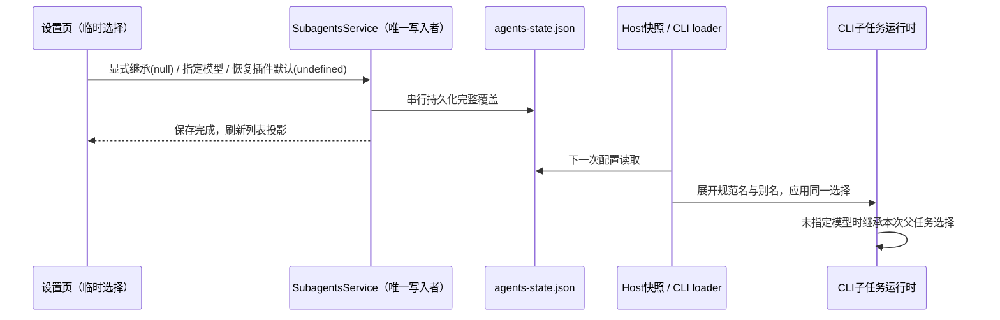

# 官方插件子智能体模型默认值与显式继承

## 问题与产品规则

四个 Office 插件的 `visual-judge` 固定指定账号模型，账号连接不可用时在读取页面前启动失败。
设置页又把“未设置用户覆盖”显示成“继承默认”，实际仍使用插件 Markdown 中的模型。

- 官方插件交付的 agent 不绑定具体供应商、账号、型号或推理档位；省略 `model` 和
  `thoughtLevel`，沿用主任务在创建子任务时的完整模型选择。扫描所有官方插件 agent 防止回归。
- 用户显式模型覆盖优先于插件默认；升级插件不清除用户已保存的选择，也不自动迁移真实用户文件。
- 设置页明确区分“继承主任务模型”和“使用插件默认”。显式继承必须跳过插件固定模型及其档位；
  恢复插件默认必须回显实际默认模型。官方插件默认本身也是继承主任务模型。
- 不把账号不可用的显式选择静默降级为父模型。视觉任务要求主任务所选模型具备图片理解能力，
  不在插件中额外选择另一账号。

## 状态所有者与接口

`SubagentsService` 是用户覆盖唯一写入者，复用 `setPluginAgentModelOverride` 与
`agents-state.json.pluginAgentModelSelectionOverrides`，稳定插件 ID 不含版本：

| 值                                          | 含义                         |
| ------------------------------------------- | ---------------------------- |
| 键不存在 / 接口 `modelSelection: undefined` | 使用插件 Markdown 默认       |
| `null`                                      | 显式继承主任务模型及推理档位 |
| `ModelSelection`                            | 完整替换插件模型与档位       |

共享 reader、Host runtime snapshot schema、CLI loader 必须保留 `null`，禁止用真假判断把显式继承
还原为插件默认。`AgentSummary.modelSelectionOverride` 同样区分 `undefined` 与 `null`；
`modelSelection` 投影有效配置，`defaultModelSelection` 保留插件原值用于展示和恢复。
内置子智能体沿用原来的无覆盖即继承语义。

不改变已运行子任务的快照；下一次子任务创建消费刷新后的配置。写入失败回退 UI 临时选择，
保存成功后的刷新失败不回滚持久化。复用原 Host 权威源、配置刷新和 stdio 链路；
不新增 session、队列、远控客户端或并发写入路径。

## 验收

1. 扫描全部官方插件 agent：无固定模型/档位；四个 `visual-judge` 均可被正式 loader 读取。
2. 有固定模型的个人来源插件：指定模型 → 显式继承 → 重读/冷加载仍继承 → 恢复插件默认，
   每一步设置页与规范名/别名 runtime 投影一致，Markdown 文件不被修改。
3. `null` 经共享 parser、状态迁移和 Host snapshot schema 保留，损坏值仍拒绝；已有覆盖保留。
4. UI 无覆盖时显示插件真实默认值；继承操作保存 `null`，恢复默认删除覆盖，推理档位不串用。
5. Desktop E2E 覆盖官方插件模型/档位覆盖、继承保存、重进设置回显与恢复默认。
6. 聚焦单测、CLI 调用方测试、根与 CLI 类型检查/Lint、架构检查；环境受限如实记录。
