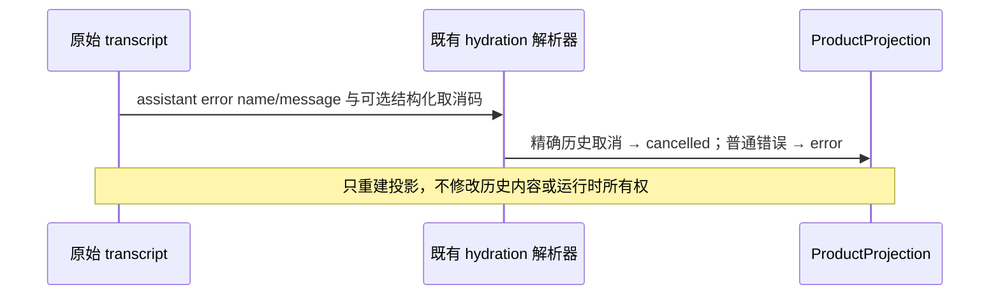

# PR #2 验证修复范围

## 事实与边界

PR 当前 GitHub checks 成功；本地 main→PR affected 选中 1353 个文件，其中 30 个文件、252 项失败，
并有 5 个未处理错误。逐组复现并以当前源码及已接受的产品规格区分真实缺陷与失效测试预期。
不得恢复已经移除的应用账号登录、固定官方账号模型或手机远控能力来满足历史测试。

## 产品与测试合同

- 用户数据统一通过公开 paths / `UWORK_DATA_ROOT_DIR_NAME` 定位 `.uwork`。修正用户数据夹具，
  保留工作区内 `.zcode/config.json` 兼容语义；不对所有 `.zcode` 字符串做无差别替换。
- 产品文案按当前 UWork 输出验收，协议 ID、插件 ID 与兼容入口仍使用源码定义的稳定值。
- 应用 OAuth 的退役合同沿用 `specs/custom-providers-only.md`：读取为 signed-out，登录/刷新明确失败，
  callback/poll/401 分类不能恢复或删除历史账号；登出只广播 signed-out，保持自定义 API Key。
  不再用历史登录成功流程触发永不完成的 deferred promise。用可执行的拒绝、零网络、零凭据副作用、
  通知及重复调用场景覆盖旧 RPC 安全边界；企业身份的现有验证仍须运行。
- Provider Registry / Provisioning 仍验证当前源码提供的事务、完整替换、回滚、allowlist 与幂等性。
  需要账号数据的底层契约测试使用显式注入的测试源或端口，不依赖退役应用登录或假定发布配置必含旧账号。
- 官方发布配置按当前配置验证其不提供的账号边界；保留具体型号/别名/档位/迁移算法的契约覆盖，
  用 case-local 配置 fixture 测试被保留的算法，不能以空集合断言掩盖验证缺失。
- 用当前公开接口和入口验证 Agent 启动、取消、日志和 stdio 参数。测试必须立即接住异步拒绝，
  不允许用延时、宽松超时或忽略未处理错误掩盖时序问题。
- MCP OAuth 是独立且仍受支持的第三方服务授权，不能与退役的模型供应商应用登录混同。
  保留动态注册、PKCE、加密凭据、跨进程单次刷新、错误分类和待授权状态验证；修正当前用户根
  和 UWork 客户端名称的夹具，不能改成全局拒绝或移除有效授权能力。
- CLI 的用户级配置、插件权限及官方市场可信来源按当前公开解析器准备测试，不放宽官方市场
  保留名称的信任校验；保留参数透传、秘密隔离和退出码等真实子进程验收。
- Bootstrap 的包级测试入口固定最多 4 个 Vitest worker，与根测试的资源预算一致。原无界默认
  worker 在全包并行时让模块加载/16MiB 编解码争用 CPU，触发保留的 5 秒用例时限；
  仅限制并发，不扩超时、不减少测试范围或断言。运行时模块加载属于测试准备，不能挤占取消
  行为的执行预算。TUI fixture 先等待 Registry/handler 关闭，再删除目录，不以 retry/sleep
  掩盖仍在写入的资源。

## 状态与依赖

不改变业务状态所有者、协议与身份隔离。服务继续是状态唯一写入者，UI 仍消费公开契约；
测试路径和注入源只属于测试准备，不引入新的运行时事实或生产配置兜底。
发现真正的生产行为缺陷时先补失败回归，并在相应已有 spec 中记录最终行为再修改实现。

## 验收

### 历史停止错误兼容

历史 transcript 缺少结构化取消码时，只在 `name=Error` 且 message 精确等于
`ZCode Protocol session stopped` 或 `UWork Protocol session stopped` 时恢复取消。
品牌变更不应把旧的用户停止恢复为失败；包含这些文本的其它业务错误仍恢复为错误。
不改变实时协议或持久化格式，不根据模糊包含关系推断取消。

1. 逐组记录原始失败、源码证据、修复机制与复测结果；不跳过、弱化断言或删除有效场景。
2. 原失败 30 文件、相关 CLI 品牌测试及相应当前能力契约通过，异步未处理错误归零。
3. 类型、Lint、架构和必要 E2E 保持通过；正常 pre-push 通过后推送原 PR 分支，本轮不绕过 hook。
4. 更新 PR 说明，保留真实验证范围；不执行 merge 或发布。
