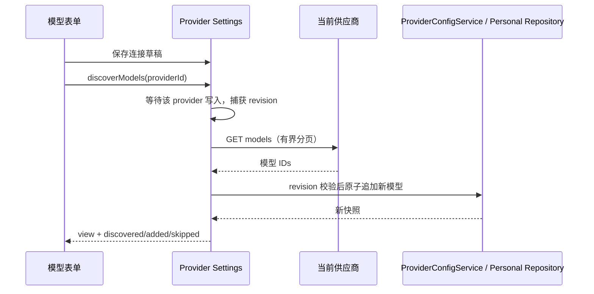
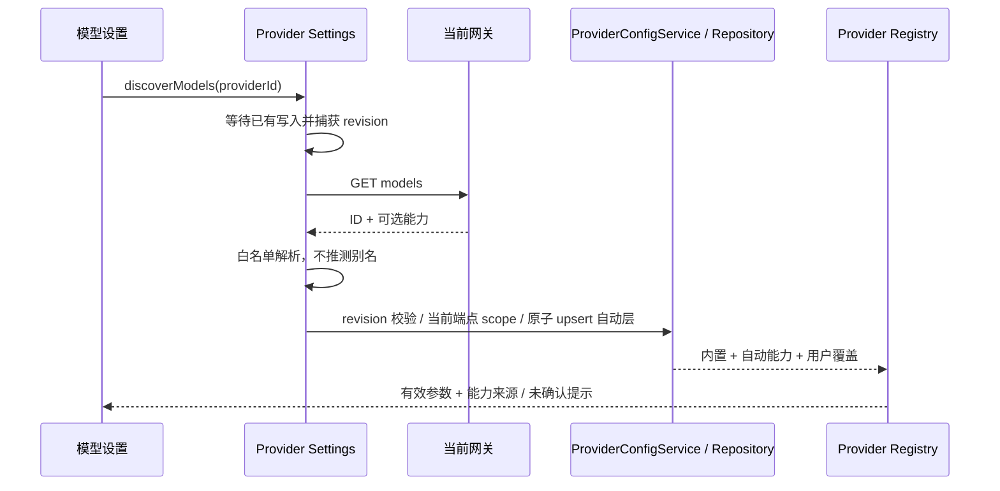

# 自动获取并添加供应商模型

## 产品规则

在模型列表的“添加模型”左侧提供“自动获取”按钮。点击后先保存当前地址、API 格式与密钥草稿，再由该设置页所属 Host 读取供应商模型列表，自动添加当前配置中不存在的模型 ID。加载期间禁止重复点击，完成显示发现、新增、已有数量；失败保留所有现有模型与配置。

首次没有模型也可获取。已有模型的启停、手动覆盖、别名和顺序不变；新模型追加。模型能力按“用户手动覆盖 > 当前端点返回的已验证能力 > 可识别型号的内置推荐”解析；不得给所有 UCAS 型号写入统一的上下文、模态或推理档位。模型列表提供的是供应商可见的 ID，不等价于已逐个完成推理连通性测试。

## 接口与安全边界

- UI → useModelProviders → IProviderSettingsService.discoverModels(providerId)，不从 Renderer 发 HTTP 请求。
- Provider Settings 服务读取已保存的 effectiveConfig，通过注入的 Host ApiClient 请求；复用现有代理/CA 网络配置。
- 支持 OpenAI Chat Completions/Responses 与 Anthropic Messages 的模型列表。根地址补 `/v1/models`；带 API 前缀的地址保留前缀后拼 `/models`；已含推理路径的地址换成同级 models。根地址 404/405 时仅同源尝试 `/models`。
- OpenAI 使用 Bearer，Anthropic 使用 x-api-key 和 anthropic-version；保留用户配置的 headers。HTTP/HTTPS 自定义服务可用，禁止 URL 用户信息、查询凭据和重定向。密钥只发送到该供应商的同源地址，不记录响应原文或密钥。
- 单次总超时 15 秒，最多 20 页、5000 个 ID、4 MiB 响应；分页只使用服务返回的 last_id 构造同源 after_id，不跟随 next URL。去重、去掉空 ID，拒绝损坏结构及超预算的部分列表。
- Host 同一供应商进行中的发现请求合并；获取后按开始时的 Registry revision 校验。配置变化、供应商删除或跨 Host 文件修订冲突时拒绝整个导入，要求重新获取。
- ProviderConfigService 在现有 Personal Repository 事务内一次性合并新 ID，避免部分写入。Facade 复用按 provider 串行写入队列。

Desktop 与 Web 共用同一服务边界；不改 workspaceIdentity、Host owner/lease、desktop-continuous 或 web-remote-replayable 语义。远端旧 Host 未提供新方法时显示错误，不退回 Renderer 网络请求。

## 验收

- 根地址、/v1、带前缀和完整推理路径；OpenAI/Anthropic 认证与分页。
- 空列表、重复 ID、已有禁用模型、错误结构、401/403、404 fallback、重定向、超时与超预算。
- 新增一次性落盘，重复点击不重复新增；请求中改连接/删除供应商/并发写入不接受旧结果。
- UCAS 自动发现不再保存统一的 1M / 文本图片 / low-high-max；刷新已有自动能力且保留用户手动覆盖。仅有 ID 的未知型号明确提示能力未确认。
- Electron E2E 用本地模型列表服务验证按钮位置、刚编辑的连接保存、加载提示、成功导入、重复获取和错误不丢模型；重建安装保留用户配置。

参考：[OpenAI Models](https://developers.openai.com/api/reference/resources/models/methods/list)、[Anthropic Models](https://platform.claude.com/docs/en/api/models/list)。

## 验证记录

2026-09-23：服务测试 23 项、UI 测试 6 项通过；其中发现协议与原子导入测试覆盖分页/认证、重复项、旧配置保留、请求合并和修订冲突。Electron E2E 使用独立本地接口完成模型获取、加载态、自动追加、重复点击不新增、401 后模型保留。未使用真实供应商密钥运行自动化测试。

`pnpm typecheck`、架构检查通过；Lint 为 0 错误、57 项既有警告。产物使用 macOS arm64 `.app` 目录打包，不依赖 DMG。

## 导入后编辑参数的版本传递

ModelProviderSection 必须把 useModelProviders 返回的 ProviderSettingsView.revision 传给模型编辑卡片。打开弹窗时记录该版本，保存时由原有 facade 校验；不得使用默认 0，也不能在保存瞬间用最新版本覆盖草稿版本以绕过冲突检查。真实并发修改仍应拒绝旧草稿。

回归场景：自动获取模型 → 修改上下文窗口并保存 → 重新打开确认；再修改一次，验证保存后的新版本继续生效。

该场景已用修复前 Electron 构建复现 `expected 0, current 8`，修复后两次参数编辑、保存、重开均通过。新增服务回归确认过期 basedOnRevision 仍会被拒绝，已保存的上下文不会被旧草稿覆盖。代码修复仅补充设置页到编辑卡片的 revision 传递，不修改服务端并发校验。

## 模型能力与自动来源（2026-11-04）

### 产品规则与来源

- 模型名单与模型能力是两种事实。协议 `/models` 只含 ID 时仅确认模型可见，不能认定上下文、图片支持或推理档位。`supported_endpoint_types` 表示接口协议，不表示输入模态。
- 发现输入统一为 `DiscoveredModelInput = string | { id: string; config?: ModelConfigObject; preserveCapabilities?: true }`。保留字符串兼容；网关解析器仅接收白名单的上下文、最大输出、输入模态与明确推理档位，不接受远端任意配置/请求映射。显式 effort 档位采用客户端持有的当前 API 协议映射（Chat reasoning_effort / Responses reasoning.effort / Anthropic output_config.effort），不只修改 UI 档位；明确不支持推理时使用空映射，不发送伪造 disabled 档位。`supports_reasoning=true` 不能推导具体档位；明确 false 可表示禁用。返回的推理档位按客户端语义顺序从低到高规范化，不依赖服务端数组顺序，确保现有“最后一档为默认最高档”合同成立。
- ProviderConfigService 唯一拥有模型成员、自动发现能力与用户覆盖。自动能力以可选 `discoveredProviderModelRules` 独立持久化；有效顺序为内置 → 当前端点自动能力 → 用户普通/固定覆盖。自动规则带 apiType/baseUrl 作用域，连接改变时旧能力不再应用。目录请求失败与成功返回 ID-only 必须区分：Host 仅在读取失败/套餐 ID 未出现在目录时设置 preserveCapabilities，追加成员但保留原自动能力；远端响应不能提供该内部标志。
- 重新发现会刷新返回模型的自动规则（包括已存在模型），但不改变用户覆盖、启停或顺序，不自动删除本次未返回的模型。名单总数、新增数与已有数仍分别统计。revision 校验、Host 写入串行和仓库事务保持原边界。
- 只匹配通用规则或不可识别的网关别名时，Settings 以 `capabilitySource=unknown` 明确提示“能力未确认，以下为兼容默认值”；兼容默认只用于已有运行合同，不宣称为真实规格。命中具体型号时为 builtin，具有当前网关能力时为 gateway；用户覆盖仍独立标注。
- 不推测 `ucas-gpt-*` 等逻辑别名对应的真实型号。当前网关未提供结构化能力时显示未知，并允许用户设置已确认规格。

### 旧配置迁移

旧版 UCAS 自动值曾写成个人覆盖。只对普通 UCAS 精确规则中可识别的旧统一播种形状清理同值叶子；偏离默认的用户修改、其他字段和 enabled 必须保留。固定模式不迁移。该历史格式没有来源信息，因此与旧默认完全同值的手动设置无法区分；按旧自动值处理，后续所有自动数据均独立保存，不再产生歧义。迁移幂等且通过 Personal Repository 原子写入；安装前备份本机配置。

### 回归验收

1. 两个不同模型从网关返回不同上下文、输入模态和推理档位，导入后逐项不同，且重启后保留。
2. 已存在自动能力刷新；手动上下文/图片支持/推理覆盖、禁用状态和顺序不被覆盖。连接改变、过期响应和跨 Host 修订冲突不得污染当前端点。目录暂时不可用时保留上次确认能力并报告错误，不伪装成功刷新。
3. 仅 ID 的具体已知型号跟随内置推荐，未知别名有明确未确认提示；不显示统一 UCAS 参数为真实能力。错误或不完整字段不被信任，错误整包不部分写入。
4. 旧 UCAS 播种值迁移并保持偏离默认的用户修改；固定配置、非 UCAS 配置不受迁移影响。重复升级/获取幂等。
5. Desktop E2E 验证自动获取 → 参数差异 → 编辑覆盖 → 服务刷新 → 保存重开；本地构建安装后验证真实 UCAS 返回 ID-only 时的未知提示及正常启动。

## 2026-11-04 回归结果

- Provider / Provider Node：8 个聚焦文件 109 项通过；服务：3 个聚焦文件 48 项通过；UI：4 个聚焦文件 26 项通过。包含先红后绿的固定值污染、自动层刷新、目录失败保留、仅应用模型无密钥副作用、身份/名单并发、推理档位排序和零新增能力刷新回归。
- Electron：1 个真实界面用例通过；本地 `/models` 两次请求，导入 3 个模型，验证 32K 纯文本与 128K 图片/PDF 的差异、49,152 手动上下文保留、自动基线刷新到 65,536、重启持久化和未知别名提示；未发推理请求。
- Node 24.14.0：全仓 `pnpm typecheck`、`pnpm lint`（330 项已有警告、0 错误）与 `pnpm architecture:check --changed` 通过；变更文件格式检查通过。
- 扩展排查发现的 12 项静态目录/文案测试失败，已在隔离的原始 HEAD 源码副本重放确认同样失败；未为本次修复改动模型目录或降低这些断言。

## models.dev 目录优先（2026-11-04）

本节 supersedes 上述自动层优先级：用户要求自动参数优先使用 models.dev，故新顺序为个人覆盖 > models.dev > 网关明确参数 > 内置。见 [目录合同](models-dev-catalog.md)。输入模态涵盖 audio，非聊天模型不得混入聊天选择。

2026-11-04 最终优先级修订：启用 models.dev 的 Host 仅从网关导入名单，自动参数使用 models.dev，未匹配/不可用使用软件内置规则；个人配置最高。旧网关自动层清空不改个人层。底层无目录集成调用仍保留原网关元数据合同。详见 `models-dev-catalog.md`。
