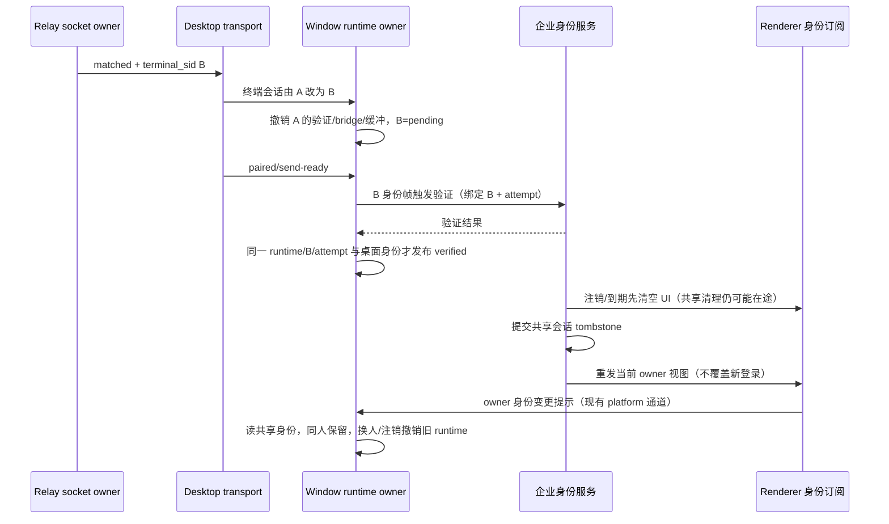

# 手机远控的企业身份准入（方案 A）

状态：2026-10-27 起草。范围只做"手机端必须用企业微信身份登录、桌面端校验后才放行"，
**不含**把远控搬进 ucas-proxy 的企微应用（那是下一步）。

## 一、要解决的问题

现在的自建远控走 HMAC 配对：二维码里带 `sid` + `hash`（设备凭据的哈希），谁扫到码谁就能控制这台机器。

- 设备凭据是**持久化**的（`authStorageProvider.load()` 复用），二维码里的 `t` 只校验形状、**不做新鲜度判断**，所以那张码等于长期钥匙；
- 身份完全缺位：与员工的企业微信身份无关，离职、转发截图、旧码留存在手机里都拦不住。

上游官方的远控（`oauth-v2`）是"账号授权"（要求 z.ai / BigModel 的 JWT）。我们这条线已经把账号入口删掉，
不能也不该回到账号体系——企业身份在 ucas-proxy 里已经有了。

## 二、方案 A 的边界

手机页在连上 relay 之后、桌面把控制权交出去之前，多一道**企业身份准入**：

1. 手机页用企业微信网页授权登录（复用 ucas-proxy 现有端点，不新增后端接口）；
2. 手机把这个 JWT 通过已有的应用层 payload 通道交给桌面；
3. 桌面拿 JWT 向 ucas-proxy 校验，按策略决定放行还是拒绝；
4. 拒绝时给出可读原因（手机页与桌面日志都能看见）。

**relay 不动**：它继续不持有身份、不校验 JWT、不解析 payload（契约见 `packages/relay/CONTRACT.md`）。
身份校验发生在桌面与 control-plane 之间。

## 三、契约

### 3.1 二维码新增两个参数（仅 HMAC 通道）

| 参数              | 含义                                                            | 约束                                                                            |
| ----------------- | --------------------------------------------------------------- | ------------------------------------------------------------------------------- |
| `org`             | 桌面当前选中的组织 id（`EnterpriseIdentityView.selectedOrgId`） | 非空、长度 ≤256                                                                 |
| `enterprise_auth` | ucas-proxy 的 control-plane 基址                                | 必须 `https:`（本机调试允许 `http://localhost`/`127.0.0.1`），不得带 query/hash |

两者同时出现才启用企业准入；缺任一项即视为未启用（保持旧行为，避免半配置状态把手机挡在门外）。
二维码里只有组织与基址，**不含任何凭据**。

### 3.2 新增应用层 payload（手机 → 桌面）

```ts
{
  zcode_type: "enterprise-identity";
  token: string;
}
```

顺序契约：启用企业准入时，终端在配对完成后**必须**先发这一帧，桌面在通过校验前
**丢弃**该终端的其它 payload（不排队、不缓存，避免"先放行后校验"的窗口）。

### 3.2.1 企业准入绑定当前手机连接（2026-11-04 回归修订）

- `WindowControlRuntime` 唯一拥有企业认证状态，但已验证资格必须绑定 relay 在 `auth_ack` / `pair_status_ack` 提供的当前 `terminal_sid`，不能只绑定长期 device SID 或窗口。
- Desktop transport 在匹配消息送达时先发布终端会话变化，再恢复 paired/send-ready。首个终端或终端替换时，manager 清除旧已验证状态、旧 bridge/attachment 与待发业务帧，重新等待企业身份帧。
- 配置企业准入但当前终端标识缺失时，不能以旧验证或旧 HMAC 权限替代；拒绝企业身份验证并关闭该远控 runtime。未启用企业准入的 legacy HMAC 保持原有行为。
- 企业 HTTP 验证结果须同时匹配当前 runtime、终端 SID 与验证尝试代次，并在发布前复核桌面当前企业身份；旧终端的迟到成功/失败均不得改变新终端资格。
- Renderer 订阅企业身份 owner 的变更，通过现有 platform 通道发送失效提示；Main 重新读取共享身份事实。同用户续期保持连接，组织/用户切换、注销或已启用身份读取失败时撤销旧 runtime；通知内容本身不授予权限，迟到身份读取不能撤销新 runtime。
- 注销和到期仍先清空 UI 投影，但共享会话清理提交后必须再发布当前 owner 视图，保证 Main 能在提交后复核身份。提交前的 UI 事件不能代替这次通知；重发当前视图而不写入旧退出状态，避免迟到退出覆盖已经开始的新登录。
- 验证前丢弃应用请求和 raw RPC，且不把旧 bridge 的业务数据发给新终端；错误反馈可以发送。验证成功后再请求当前手机查看状态。



### 3.3 新增失败原因

`enterprise-identity-required`（没发身份帧）、`enterprise-identity-rejected`（校验不通过：组织不符或人被拒）。

### 3.4 校验与策略

- 桌面校验：`POST {enterprise_auth}/api/auth/refresh`，`Authorization: Bearer <token>`；成功返回 user（含组织与用户标识）。
- 默认策略：**同组织且同一个人**（谁登录的桌面，谁才能控）。
- 配置可放宽为"同组织任意员工"：`enterpriseAuth.allowSameOrgAnyUser = true`（客服/演示场景），默认 `false`。
- 桌面自身未登录或取不到组织时：企业准入视为不可用，**不生成** `org`/`enterprise_auth` 参数（回到旧行为并在日志里说明），不生成一张必然失败的码。

### 3.5 手机页登录流程（复用现有端点）

1. 页面发现二维码带 `enterprise_auth` 且本地没有该组织的 token → 取 `GET {base}/api/auth/authorize?org_id=<org>&redirect_uri=<当前完整地址>` 得到企微授权链接并跳转；
2. 企微回调回本页（保留二维码参数 + `code`）→ `POST {base}/api/auth/login { code, org_id }` 换 JWT；
3. token 存 `sessionStorage`（键含组织 id；关闭页面即失效），随后正常配对并上报身份帧；
4. 登录失败或 token 被拒：显示失败原因，允许重新登录（清掉本地 token 再走一次）。

## 四、不做什么

- 不改 relay 的注册/鉴权协议，不给 relay 加身份或 JWT 校验；
- 不动官方的 `oauth-v2` 通道；
- 不做设备凭据轮换/过期（那是另一条独立修复：二维码长期有效的问题仍在，本方案只是把"谁能用"从"拿到码的人"变成"登录了企微且被允许的人"）；
- 不做已配对终端列表/撤销 UI。

## 五、验收

1. 未开企业准入时行为与现在完全一致（旧二维码不带新参数也能连）。
2. 开启后：浏览器直接打开带参二维码 → 被引导到企微授权；授权回来能连上。
3. 换一个组织的账号（或另一名员工，未放宽策略）→ 桌面拒绝，手机看到 `enterprise-identity-rejected`。
4. 不带身份帧的连接 → 桌面拒绝，手机看到 `enterprise-identity-required`。
5. relay 侧零改动；`packages/relay` 的契约测试与集成测保持通过。

## 六、企微工作台入口（backend=uwork，免扫码）2026-11-03

上面第 1–5 节是看板 A：**扫码进页面**。本节是另一条入口——员工从**企业微信工作台**打开自建应用，
页面在企微内置浏览器里完成企微身份登录，然后**直接选设备连接，全程不扫码**。只对
`backend = "uwork"` 的自有后台生效；`ucas` 模式保持第 1–5 节行为不变。

### 6.1 入口与配置

- **企微自建应用主页就是一个干净地址：`https://<后台同源域名>/remote/v4`**，不带任何参数。
  页面与后台**同源**（nginx 在同一 host 上发页面静态文件、把 `/api` 反代到后台），所以：
  - `apiBaseUrl` 由页面自己的 `location.origin` 推出（不再有 `enterprise_auth`）；
  - 组织由**请求 Host** 解析（照 ucas-proxy 的口径：显式映射 → 唯一可登录租户 → 唯一租户），
    不再有 `org`；
  - `backend` 由 `GET /api/auth/wecom/web-config`（同源、公开）确认，返回
    `{backend:"uwork", tenantId}`；不是本后台的 origin 直接 404，页面回落到二维码/显式参数入口。
    该探测不属于官方 OAuth 认证：默认 HMAC 即使收到官方 `code` / `authCode` / `error` + `state` 参数，也不调用官方回调或登录服务。无配对参数且无显式企业基址时允许一次固定同源路径的公开 GET；使用 `credentials: omit`、`redirect: error`，不转发 query、令牌或请求正文。404 后展示扫码入口。扫码直连仍不发此探测。

  - 组织映射在后台用 `TENANT_HOSTS="host=tenantId,host2=tenantId2"` 配置（缺省空 = 单租户自动解析）。
- 页面仍**向后兼容**显式参数：URL 带 `backend`/`org`/`enterprise_auth` 时以参数为准（二维码路径照旧）。
- 桌面随包配置 `config/mobile-remote-control.json` 的 `enterpriseAuth` 增加
  `"backend": "uwork"`（缺省 `ucas`）；只有 uwork 才启用设备登记与配对应答通道。
- 企微侧：应用「可信域名/网页授权回调域」要包含该同源域名；后台 `PUBLIC_URL` 必须是
  HTTPS 公网 origin（回调 `/api/auth/wecom/callback`），且与页面同源。

### 6.2 页面准入（只允许企微应用）

- `backend=uwork` 时，页面在**任何网络请求之前**校验 UA 含 `wxwork`；否则直接渲染
  `wecom-app-required` 失败页（文案「请在企业微信中打开」），不连 relay。
- 本机 `localhost` / `127.0.0.1` / `[::1]` 放行方便开发与自动化；其余一律拒绝。
- 这只是体验层门禁：真正的准入仍是企微身份 + 桌面端二次校验（见 6.4）。

### 6.3 登录（企微内置浏览器，免扫码）

1. 页面 `POST {后台}/api/auth/wecom/attempts {tenantId: org, mode:"web", returnTo:<本页 URL>}`；
2. 后台返回 `https://open.weixin.qq.com/connect/oauth2/authorize?...scope=snsapi_base&state=<attempt>`；
3. 企微静默授权后回跳到本页（带 `state`/`code`）→ 页面 `POST /attempts/:id/complete {proof,code}`
   → `POST /attempts/:id/claim` 换不透明会话，存 `sessionStorage`（关页面失效）；
4. 回调里的 `state` 必须与页面记录的 attempt 一致，`proof` 不出页面。

后台侧复用既有 attempt/callback/claim 与 `provider.identity`，只新增 `mode:"web"` 的授权链接与
`returnTo` 回跳（https，或本机回环）。开发态合成登录（`UWORK_DEV_SYNTHETIC_LOGIN` + 回环
`PUBLIC_URL`）在 web 模式下同样可用，便于本机验收。

### 6.4 设备目录与配对应答（材料不落后台存储）

| 步骤         | 端点                                                                                 | 说明                                                               |
| ------------ | ------------------------------------------------------------------------------------ | ------------------------------------------------------------------ |
| 桌面登记     | `PUT /api/client/remote-devices/:sid`                                                | `{deviceMid,name,platform,ttlSeconds≤600}`，幂等心跳，**不含密钥** |
| 手机列设备   | `GET /api/client/remote-devices`                                                     | 只列本人 TTL 内设备                                                |
| 手机请求配对 | `POST /api/client/remote-devices/:sid/pairings`                                      | `{id,expiresAt}`（≤60s）                                           |
| 桌面应答     | `GET /api/client/remote-pairings/next?deviceSid=` + `POST .../:id/answer {sid,hash}` | 长轮询 ≤30s；材料只留在后台进程内 Map（一次性）                    |
| 手机取材料   | `GET /api/client/remote-devices/:sid/pairings/:id`                                   | `answered` 时一次性返回 `{sid,hash,org,enterpriseAuth}`            |

- 组织/成员隔离：全部端点按会话的 `tenant_id + user_id` 过滤，跨成员一律 404；
  因此"同组织任意人可连"在本入口不成立（`allowSameOrgAnyUser` 不参与），比扫码更严。
- 手机拿到 `{sid,hash}` 后走**既有 HMAC 连接**：relay 与协议零改动；
  连接后仍发 `enterprise-identity` 帧，桌面端按第 3.4 节再校验一次。

### 6.5 验收

- 页面单测：UA 门禁（普通 UA → `wecom-app-required` 且零请求）、企微 UA + 已登录 → 设备列表 →
  配对 → `connect({sid, passHash, enterpriseAuth, enterpriseOrg})`；带 `sid/hash` 的扫码链接行为不变。
- 桌面单测：登记/心跳/只应答同人/材料缺失不应答/注销。
- 后台单测：设备 TTL 与隔离、列表不含密钥、配对一次性、过期与跨成员、web 授权 URL 与回跳。
- 真机验收（需企微管理员）：工作台点开 → 静默授权 → 设备列表 → 连接；普通浏览器被拒。

### 6.6 不做（本批）

- 不改 relay/协议；不给 relay 加身份。
- 不做后台菜单开关、`remote` 渠道准入、管理台设备页与审计（下一批，接口已按 `/api/client/*` 命名）。
- 不做设备凭据轮换/过期策略本身；ucas 模式不提供免扫码。
