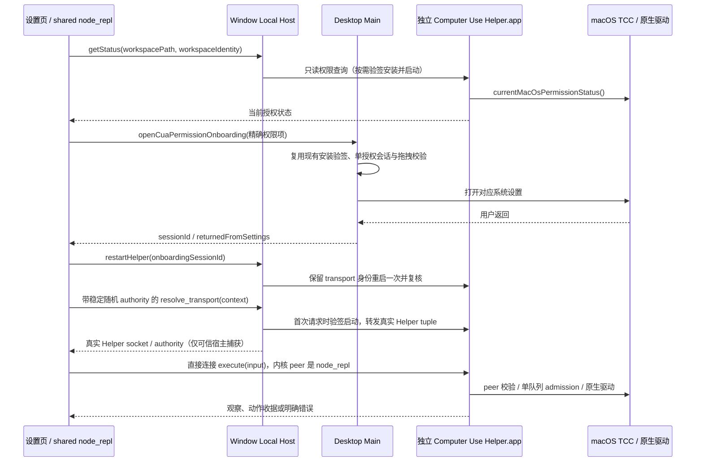
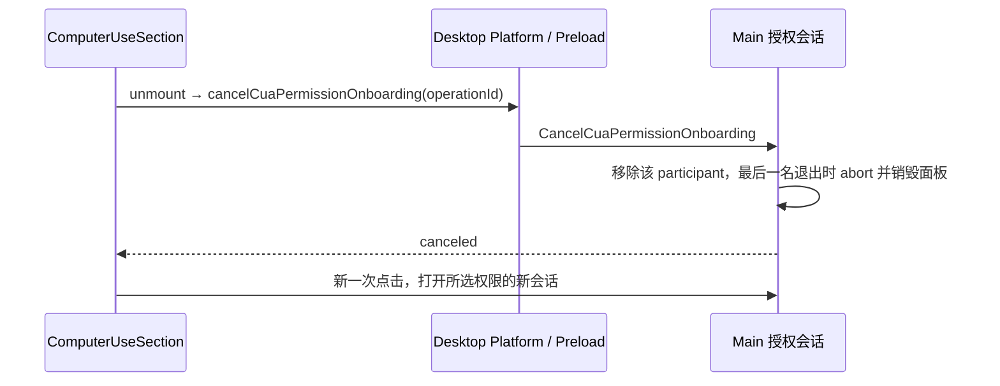

# macOS 电脑控制运行时恢复

## 背景与目标

用户在 UWork 0.1.2 的电脑控制设置页点击辅助功能、屏幕录制入口，均停在「Helper 可能还在启动」。已核对安装包及源码：`@zcode/zcode-cua` 是 fail-closed 占位包，发行包不包含独立 Helper。2026-10-26 用户明确选择恢复实际能力并补齐 Helper 与运行时。

恢复截图对应的本地 macOS desktop-continuous 链路：真实 Helper 返回系统权限，两个按钮打开对应系统设置，授权后重启同一 Helper，模型通过既有 shared node_repl 操作本机应用。远端 workspace、独立服务端和 subagent 不获得本机桌面控制能力。系统授权始终由用户在 macOS 中完成。

## 实现来源

- 驱动固定为公开的 `@trycua/cua-driver@0.28.2`，以其发布包的导出和声明为准；提供同进程 `currentMacOsPermissionStatus()` 和 `CuaDriver`。
- 协议翻译参考 Zcode-CE/Zcode-CE 提交 `7fc3bfe252e7fb1833dc06113e3c2c012910996d` 的公开适配代码；保留许可和来源。修正其身份隔离、队列停止与 macOS 权限映射，不能把该项目的绕过 Helper 路径带入 UWork。
- 不依赖不可获得的原私有 producer，不伪造成功、不把 unknown 当成 denied。

## 所有者与边界

- `packages/zcode-cua` 是真实运行时唯一所有者。原生驱动仅在独立 `.app` 的 SEA 进程内加载；Host、Main、Renderer 和 node_repl 不直接加载驱动。
- CLI plugin-host 时序为：sanitize 将 socket/authority 捕获进私有存储并删除环境值 → 验证官方 shared node_repl 启动身份 → 导入模块（环境无凭据）→ 仅在可信 `module.main()` 期间临时恢复完整 socket/authority → `finally` 按进入 main 前的值恢复或删除；普通 MCP/Bash 不得到这组 bearer，真正动作由取得专属 transport 的 node_repl 直连 Helper。
- Local Host 仍负责 Helper 生命周期和 transport 路由；Main 仅负责现有原生窗口/授权入口，不保存任务状态。
- 保留懒启动规范：Agent spawn 只注入 Host 已铸造的连接发现 tuple，不做 Helper 安装、启动或探测。Host broker 只接受带鉴权的 `resolve_transport`，首次电脑控制请求才获取真实 Helper transport；它绝不代理 execute/close/shutdown，否则 Helper 的内核 peer 将错误变成可信 Host，让同 UID 窃取发现凭据的进程绕过真实调用方校验。实际命令必须从 node_repl 直连 Helper。Helper 重启不改变已注入 Agent 的发现 tuple。
- broker 只开放有限方法；无凭据只允许 ping 和无用户内容的权限预检。所有执行、关闭会话、停止进程和接管 transport 必须验证随机凭据。Unix socket 位于用户私有目录，权限 0600，请求有大小与时限约束，不提供 eval、任意驱动方法或网络监听。
- 仅当私有目录中同 UID socket 探测明确 `ECONNREFUSED` 且 inode/dev 未变化时回收遗留 socket；活跃或结果不确定时 fail-closed，authority 保留。
- 执行上下文以 `workspaceIdentity?.trim() || workspacePath || workspaceKey`、`remoteSessionId`、`sessionId` 组合隔离；拒绝远端身份和 subagent。排队操作在 admission 时再检查 stop/abort；取消后不自动重放可能已发出的动作。
- Local Host 的 Helper admission 使用共享远端 identity 解析器；非空本地 identity 不等同于远端。保留 authority mode、远端信号、注入 resolver 和插件边界。
- stop 必须停止本会话后续队列并释放原生输入；在原生会话清理完成前不 admission 新动作。截图坐标必须关联最新窗口观察，无法证明映射时明确拒绝。
- `click/drag/type_text/scroll/set_value/press_key` 原生调用发出后若取消、崩溃或无可解析收据，结果保守标记 `action_sent:true/possibly_sent` 且不重放；调用前校验失败、只读操作与显式原生拒绝仍分别按未发送边界或实际收据处理。
- 原生具名会话由 Helper 在首次观察/输入前显式 `start_session`，同 workspace/session 只声明一次；`end_session` 后清除本地声明，只有 `closeSession` 解除 stop latch 后的下一次显式调用才重新声明。应用/窗口列表不声明具名控制会话，权限预检不加载驱动。固定 `cua-driver-rs-v0.28.2` 的 [core session](https://github.com/trycua/cua/blob/cua-driver-rs-v0.28.2/libs/cua-driver/rust/crates/cua-driver-core/src/session.rs) 可在初始动作隐式建立 lifecycle，但 [core tool](https://github.com/trycua/cua/blob/cua-driver-rs-v0.28.2/libs/cua-driver/rust/crates/cua-driver-core/src/tool.rs) 明确拒绝已结束 label，复用必须显式 start；此处修复关闭后复用合同，不将首次 AX 必失败写为已确认根因。失败的观察/输入从不自动重放。
- Helper 安装保持来源限定、bundle id、架构、完整签名和 team 校验，原子替换。开发态只在显式 unsigned-local 模式接受 ad-hoc；正式包不能用该变量绕过验证。构建验证与正式签名/公证验收分别报告。
- 每条控制连接额外通过 Node-API / Swift 原生库在 Helper 内复制 socket fd、读取内核 peer UID/PID，校验与 Helper 同 Team 的有效签名及 UWork GUI 主进程祖先；解释器模式不能作为 GUI 根锚点。没有原生校验器或校验失败即拒绝控制。只有编译为开发 Helper 且显式携带两项本机开发开关时允许开发进程。
- 全部 SDK JavaScript 嵌入 SEA；Resources 只保留原生库、声明与许可证，不允许以 require/spawn 加载用户可改写的外置 JS 或校验脚本。Node-API/Swift 库与驱动共享 hardened library validation 的同 Team 边界。
- SEA 固定 `execArgvExtension: "none"`，禁止 `NODE_OPTIONS` 在鉴权代码之前注入脚本；真实产物必须验证预加载 marker 未执行。原生验证器禁用继承的 Node/DYLD 注入环境。
- 物理 standalone Helper 自己持有空闲寿命；300 秒没有请求且无在途调用才退出。窗口 Host dispose 只断开自身代理与 handle，不关闭其他窗口正在使用的共享 Helper。

## 接口与状态

继续提供现有 `createComputerUseRuntime`、`broker/server`、`broker/ports` 公共入口。node_repl 运行时只是带 authority 的 broker 客户端。Helper 内部复用公开驱动协议翻译，返回既有 content / structuredContent 结果。

权限查询不触发屏幕捕获和系统权限弹窗；成功快照可省略 `available`（现有 Host 合同），谓词不能把这种快照误当成不可用。只将明确 `denied/stale` 项交给授权流程。Helper 错误必须包含真实原因，不无限重试启动。

连续按钮回归还发现 Renderer 平台适配缺少既有 `cancelCuaPermissionOnboarding` 的 preload 委托。
设置分区卸载发出的取消因此静默丢失，原生授权面板和会话残留，下一项权限请求被合并到上一会话。
恢复同一公开方法的桥接：分区卸载→按 operationId 取消当前 participant→最后参与者退出时清理原生面板；
清理完成后下一次显式点击必须为所选权限打开精确面板。不能通过两次冷启动规避连续操作验收。

## 构建与代码位置

- `packages/zcode-cua/`：公共协议、broker 客户端、Helper 服务、生命周期/安装器、驱动翻译与聚焦单测。新实现纳入架构受控模块。
- `scripts/build-cua-helper-app.mjs`：使用仓库固定 Node 构建 SEA，随包暂存目标平台驱动及许可证；产出既有 `packages/desktop/bundled-cua-helper/<arch>/ZCode Computer Use.app`。
- `packages/desktop/electron-builder.config.js` 与既有 dev/runtime 脚本：复用 producer 检测与资源落点。不得只改检测标记而没有产物。
- `packages/desktop/test/e2e/`：两项按钮、状态返回、授权后刷新场景；真实系统设置验收单独记录。

遵守现有中文根因注释、异步 IO、包公开入口与 logger 规则；不扩大 UI 能力宣称。Windows/Linux 继续按各自明确能力返回，不用 macOS 运行时假装其他平台已通过验收。

## 实施与验收

1. 先补 broker 鉴权、权限快照、会话隔离/stop 的失败用例，再恢复运行时；运行选定测试，不运行全量根套件。
2. 构建真实 macOS Helper，验证 SEA 可启动、只读权限可查询、无 authority 控制请求被拒绝、关闭清理 socket。
3. 两个权限按钮通过当前 UI→Host→Main 链路分别打开 Accessibility / Screen Recording；状态来自真正 Helper，无假状态。
4. 使用隔离测试数据执行一条无破坏性的真实应用观察/输入回读；若受系统用户授权限制，明确记录边界。
5. 执行 `pnpm architecture:check --changed`、相关聚焦单测、桌面 E2E、`pnpm typecheck`、`pnpm lint`。按实际结果报告，不把本机 ad-hoc 构建当成已签名发行验收。
6. 最后检查安装包确实带 Helper/驱动/许可证，并从随包路径启动验证。发布另行进行。
