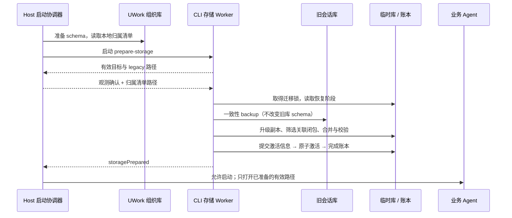
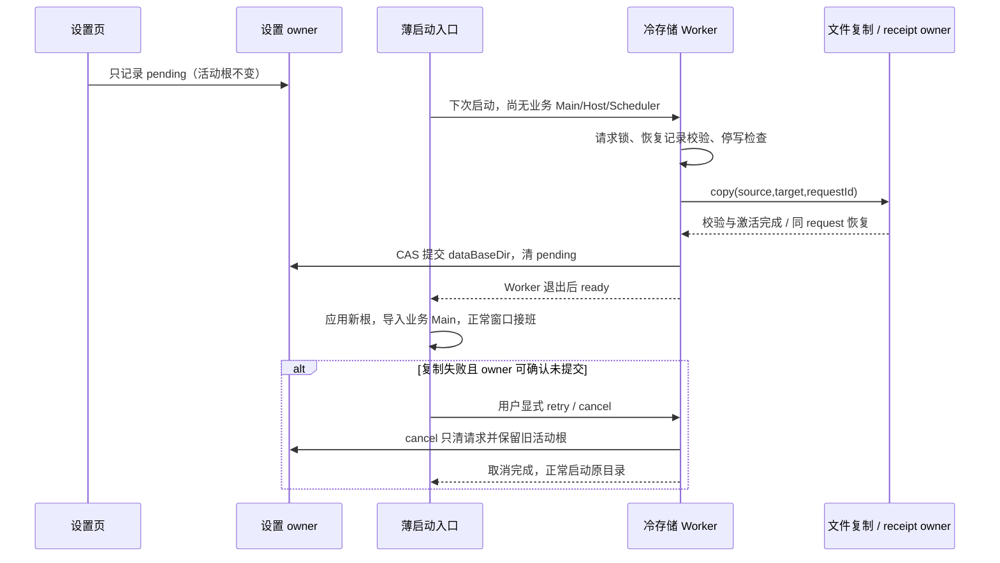

# UWork 会话库默认路径升级

状态：源码及隔离 macOS 桌面验收完成；未发布、不操作开发者真实数据库。范围为本地 UWork 默认会话库；显式自定义路径与独立 CLI 保持各自配置。证据见 `docs/testing/session-database-root-upgrade-2026-10-28.md`。

## 产品规则

新版应用首次启动，在创建或打开新的默认会话库之前完成检查。默认库从用户 home 的 `.zcode/cli/db/db.sqlite` 升级到有效 UWork CLI 根的 `db/db.sqlite`。仅开启 `UWORK_SESSION_DB_MIGRATION=1` 的受控本地 Host 链路切换默认值；默认值在配置最低优先级生成，不能覆盖用户、项目、环境变量或 CLI 显式 `storage.sessionDbPath`。独立 CLI 和尚未接入启动迁移门禁的 Source Server 保留旧默认，不扫描其他产品的历史；桌面 Release 不替远端持库服务迁移数据。

旧库保留且不升级其 schema。通过 SQLite backup 获取包含 WAL 已提交内容的一致性副本，在副本上复用当前 CLI schema migration。不直接复制正在使用的 SQLite 主文件，不删除旧 WAL。迁移本身离线完成。

Host 提供本地 UWork 任务归属清单（包括已归档、软删除任务；排除远端及其他 runtime 的任务），不读写 CLI 会话事实。CLI 验证 sessionId 与已知工作目录/identity 后迁移这些会话及其子会话、消息、输入队列、用量、目标、工作流等关联数据。另一产品的会话不进入目标库；归属无法确认时明确失败，不能猜测后建立空库。原有 cwd、workspace identity、时间、标题来源、软删除、权限和业务字段保留，不泛化替换 JSON 内的路径字符串。外部文件引用保持原指向并测试续聊所需引用。

同一 UWork 可同时使用默认库及项目显式库。Host 清单只表达组织归属；CLI 仍用同一个 `createConfig` 按每条任务的 cwd/identity 解析数据库路由。仅显式配置可证明任务当前属于另一会话库时，才从本次旧默认库迁移清单中排除；显式仍指向旧默认源库的任务继续验证和迁移。有效文件的 symlink/hardlink 别名按文件身份视为同一库，不能仅凭路径文本不同就排除。默认路由及无法证明属于另一库的条目缺席时仍失败关闭，不能按源库是否有该 ID 来跳过。路由后的清单内容指纹用于未完成尝试恢复，不绑定每次 Host 新建的临时输入文件路径。

Host 启动准备始终包括受控 fallback cwd，再准备已有 workspace 的有效 cwd；即使所有项目均使用显式库，默认全局任务库也必须在业务服务开放前完成迁移准备。

新安装没有旧库时正常建库。已有目标库不得覆盖：在目标一致性副本上合并，主键相同且内容相同则复用，内容不同时失败并保留两边。所有校验和导入在临时库完成，正常读写者只能在校验成功并提交完成记录后启动。

## 唯一所有者与接口

- Host 启动协调器仍唯一拥有启动门禁、进度与重试；Main 只呈现状态。
- CLI 迁移模块唯一拥有源快照、筛选、合并、校验、激活和迁移账本；业务 Agent 仍唯一写会话事实。
- Host 在 app 库准备好后生成临时归属清单文件。共享启动协议只传清单文件路径，避免把大清单塞进有界控制帧；CLI 严格校验内容，Host 在 Worker 退出后清理输入文件。
- `startup/storagePath` 可报告可迁移的 legacy 路径；`startup/storagePathReady` 可回传 `ownershipManifestPath`。目标及源由 CLI 配置解析决定，ACK 不能改写任意目标。
- `preparedPaths` 仅复用当前尝试中完成准备的路径；Worker 仍报告未完成的 `legacySourcePath` 时必须重新执行升级门禁，不能用同路径显式配置的 schema 准备代替迁移完成账本。控制帧统一限制为 `512 * 1024` 字符，保留每个路径最多 32768 字符的严格 schema，并覆盖 JSON 转义的最坏体积；大清单只通过文件交付。
- 仅当进程环境 `UWORK_SESSION_DB_MIGRATION=1` 且会话库配置来自默认层时使用迁移器。Host 的 storage preparation 与正常 Agent 同时携带该标志；普通 Agent 没有完成的默认迁移时不得抢先创建空库。
- 该标志只属于 Host 启动通道：CLI 的 app-server / agent-server（含 prepare-storage）入口可保留上游严格值 `1`，Bash、MCP、工具子进程及其启动的 standalone CLI 均剥离，tool-env passthrough 也不能恢复。工作区 `.env` 不能给协议进程补授该标志；普通 CLI、plugin-host 和独立 schema 工具入口不保留它。
- 本轮 rollout 仅 Desktop 本地 Host（缺省或 `projectStorageHostId=local`）启用普通 Agent 的标志。Source Server 尚无对应准备门禁，显式剥离继承的升级标志并继续使用此前默认路径；不随本轮 Desktop Release 自动切换或新建另一会话库。
- 启动路径统一：CLI 默认库、引导历史与 alias 默认库使用有效 UWork CLI 根；显式路径继续优先。既有自定义路径能力不在本次迁移中被重定向。
- 存储 Worker 与正常 Agent 都按传入的 workspace cwd 解析项目配置；不依赖 Worker 不可变的进程 cwd。项目显式会话库不得被误判为默认库而触发迁移。

## 崩溃恢复与并发

目标目录的跨进程锁串行化多个新版本窗口/Worker，锁记录 PID 与随机 owner，活进程锁不能仅凭超时抢占。锁只约束新版迁移器，不能假设它能阻止旧版写入：桌面单实例/退出流程必须确保旧 UWork 及其子进程退出；若检测到仍活跃的 UWork 旧写者，启动失败并显示关闭旧实例后重试，不能杀其他应用。

Host 仅在 Worker 报告未完成的 legacy 升级且本轮未复用时检查源库及已有目标库。macOS 用异步 `lsof` 的精确 DB/WAL 打开 PID 与 `ps` CLI 身份交叉确认；Linux 检查当前 UID 的 `/proc` CLI 进程及源文件 FD；Windows 的 CIM 无法证明精确源文件句柄，因此保守拒绝当前用户的可疑 bundled app-server 进程。目录不存在的 WAL 不参与检查。当前 Host/其 Worker 的同 PID 排除；不发送终止信号。工具缺失、命令失败或权限不明均失败关闭，不能作为“无写者”继续。保守检查可能要求关闭同名独立 CLI，错误界面必须明确提示；不能把单实例锁或迁移锁表述为已经排除孤儿旧 CLI 的证据。

源真正缺席时跳过针对不存在源文件的写者查询，仍交付归属清单并完成 fresh 账本；不能因没有旧文件而绕过后续默认 Agent 的准备断言。源/目标直接文件及祖先目录的断链通过 `lstat` 与 `realpath` 区分，访问错误或断链均失败关闭，不能用 `stat` 的 ENOENT 把离线旧库视为新装、或覆盖已有链接。已有目标的写者检查不因源缺席而省略。

Windows 的原生 `zcode-agent.exe app-server` 与 `zcode.cjs app-server` 使用同一旧写者门禁；不能依赖 `process.title` 改变 CIM 的可执行映像 Name。测试须执行生成的名称/命令匹配策略，不能只向 inventory 返回预先筛好的 PID。

Linux 以源库及 WAL 的精确 device/inode 与 `/proc/<pid>/fd` 的文件事实匹配；同一文件经根外硬链接或其他路径打开仍是活跃写者，不能仅比较路径字符串。FD 正常消失可忽略，读取 FD 身份失败仍视为无法确认、阻断迁移。

每个目标默认库使用版本化迁移账本，记录源库身份、目标、归属清单指纹与阶段。校验后的临时库与其激活信息持久化后才重命名激活；“激活后、完成标记前”崩溃时，下次启动核对激活信息后完成记录，不能因目标存在就跳过。再次启动不重复导入、也不以旧库覆盖新写入。已有目标合并前的快照必须保留，以便人工恢复；保留旧库不构成新数据无损降级承诺。

磁盘满、权限失败、源损坏、未知更高 schema、归属不明、目标冲突、锁冲突均失败关闭：不启动空白新库，不静默退回旧路径；沿用数据库启动错误/重试界面。日志只记阶段、数量和错误码，不记消息正文、凭据或用户配置内容。

安全门禁使用稳定结构化 code 呈现可操作原因：`SESSION_MIGRATION_OWNERSHIP` → `session_ownership_unknown`、`SESSION_MIGRATION_SOURCE_CHANGED` → `session_source_changed`、`DATA_DIRECTORY_TARGET_CONFLICT` → `data_directory_target_conflict`。不按错误 message 猜类别；原始 cause 中的 ENOSPC/EACCES/SQLite errno 等继续优先。界面说明原库保留、关闭旧写者后重试，目录冲突可取消请求或另选空目录。

## 重启时移动整个应用数据目录（用户确认，2026-10-28）

设置页不再在业务进程运行中复制数据。`updateDataBaseDir` 仅校验并记录带唯一 requestId 的待执行请求（sourceBaseDir、targetBaseDir、resetToDefault）；活动 dataBaseDir 保持不变，界面显示目标与“重启后迁移”。再次选择活动目录可取消尚未执行的请求。

下一次启动先完成这项冷迁移，再开放任何 tasks-index / session SQLite 或 Agent。Main 只编排独立存储 Worker 和启动状态；文件复制、校验及设置提交仍在服务/存储 owner。多个窗口/进程共享请求锁，不能重复搬迁；旧 UWork 写者存在或状态无法确定时失败关闭，不终止其他应用。

写者检查前的枚举仅能跳过顶层 `.uwork` 真正缺席且基目录可确认的情况；内部文件在扫描期间消失或访问失败必须阻断本轮复制，不能将整个根的 SQLite 清单降级为空。扫描异常后活动根和 pending 请求保持不变，不用自动重试掩盖同步问题。

复用整根复制规则，旧根保留；SQLite 使用 backup 生成包含 WAL 的完整快照，不复制独立的 WAL/SHM 作为新库伴随文件。目标有非本请求的数据则拒绝。临时根校验后写带 requestId/内容指纹的激活凭据并激活；若激活后、bootstrap 设置提交前崩溃，下次按凭据完整核验后提交，不覆盖或重新复制目标。仅成功后更新 bootstrap dataBaseDir 并清除待执行请求。失败时保留旧设置和请求供重试。

已完成会话库迁移的不可变 marker（migration UUID、清单/源身份指纹）随目录移动保持有效，绝对位置只作审计。完成 ledger 与 DB 可按字节原样移动：Runtime 只将当前 resolver 目标旁的 ledger 与当前 DB marker 绑定，Services 不解析或重写其私有路径；未完成迁移仍严格绑定原路径和 workDir。原有会话 cwd/identity 不因搬库改变；用户外部目录不移动。启动完成后 Main、Host、Scheduler 与后续 CLI 均从已提交目标启动，不出现不同进程各用一根的分叉。

验收补充：运行中仅记录请求且不复制；取消；冷启动移动包含已完成会话迁移/WAL 的完整状态；激活前后故障恢复；非空目标/锁/权限失败不提交；成功后历史可读可续聊、新任务写目标、旧根保留。

冷启动以薄 Main 入口在业务模块求值前完成；scheme、硬件加速、app home/userData 等 pre-ready 生命周期配置一次性保留，业务根 setter 从窄路径入口应用后再加载业务装配。默认数据根由 Main 最初的环境/home 优先级解析冻结，通过可信 InitLocal/WorkerData 注入，不把 Host 当前活动根环境变量当作默认值，也不新增工具可继承的环境标志。设置页只读查询此默认值；查询失败不猜 home，恢复默认不可用，明确目录仍由 owner 校验。

发布整合保留当前主线的本地开发版身份：只有编译期 local-development 标志能选择 `UWork Local Development`；Chromium 目录仍按当前主线既有规则选择（开发打包版未显式覆盖时复用 UWork 目录）。pre-ready 与业务 Main 使用同一解析规则，不能因冷迁移改变身份或数据位置，也不能用运行环境变量授予开发版信任。

依赖 SDK 的模块顶层也属于生命周期边界：`@arms/rum-electron` 加载时注册 privileged scheme，必须在 ready 前加载。薄入口只提前加载 SDK 模块；产品 telemetry 初始化、业务根日志及 `appARMSBootstrap` 仍在冷迁移提交后由业务 Main 初始化，不能把整个业务装配提前。最终 privileged scheme 注册集合同时保留 SDK 的 `rum-event`、本地媒体及插件 sandbox 权限，不能因先后注册覆盖而丢失。冷页以专用 windowKind 跳过依赖业务 Main handler 的 TTFT/用户操作追踪初始化，其余窗口时机保持原合同。以真实 Electron 冷启动验证，单纯 mock 的模块导入不构成此边界的验收。

启动页 retry/cancel 仅接受当前 attemptId；过期窗口或消息不能遗留下一轮动作。取消使用启动协调器的独立 admission：仅 data-directory-migration 的 failed 状态、已结束 Worker 确认 canCancel 且 attemptId 匹配时接纳；不借普通 retry 的错误分类判断取消能力，也不放宽普通 retry。设置页显示的 pending 目标随 owner 更新，包括当前窗口曾保存成功后由另一窗口修改或取消的情况。

固定 bootstrap home 外的 0600 操作记录保存 request、原始 bootstrap 字节及校验，覆盖 reset-to-default 激活时唯一 bootstrap 暂缺的窗口。空、损坏、冲突或坏链接记录均进入冷错误 gate；有效恢复原文中的硬件加速选择在 app ready 前应用。失败后仅在 Worker 已退出、当前 owner 请求可确认未提交时提供“取消此次迁移，使用原目录”；同请求锁及设置 CAS 下按需恢复缺席 owner 原文、清请求/操作记录，保留所有已复制数据。目标已提交时不允许取消回滚。冷窗口保留至正常窗口 ready；启动期间平台 open-url/second-instance 只按序暂存，交回原 Main handler 后移除临时监听。

同请求重试时，bootstrap 仍存在则须在允许本轮激活前刷新持久化恢复原文，保留失败期间发生的其他设置修改；bootstrap 已暂缺时保留唯一已验证原文，不得以缺省内容替代。

## 验收场景

1. 默认路径与自定义数据根；显式 user/project/env/CLI 覆盖、相对路径、standalone CLI 不误迁移。
2. 新装、旧库、WAL 未 checkpoint、升级跨度、源损坏、缺失/未知归属、软删除和子会话。
3. 目标已有内容的无冲突合并、相同数据幂等、冲突不覆盖；源库业务内容不变。
4. 不同阶段故障注入、激活后恢复、并发迁移、活锁 owner、过期孤儿锁、磁盘/权限错误；不能打开空库绕过错误。
5. 真实 prepare-storage 子进程握手与大清单文件；重复启动不重复迁移。
6. 隔离桌面升级：旧路径历史 → 新版首次启动 → 查看完整历史/续聊 → 新任务写新库 → 重启；运行现有调用轨迹 E2E，保留发布包验收与源码验证的边界。
7. Main 引用 Host 启动协调器时，Host 的 TypeScript 声明缓存独立于打包 `out/host`，只生成声明。桌面构建清理 bundle 后再次执行 `pnpm typecheck` 仍应通过，类型检查不能覆盖运行产物。
8. 发布的五个平台包在原生构建后执行无 Node Inspector 的 Chromium CDP 升级门禁。夹具的物理 schema 冻结自 `v0.1.2`，以正式包自身的 CLI/Host 初始化后核对冻结 schema，再写入合成的默认库 owned/archived/foreign 历史及单独显式库会话。测试进程和子进程 cwd/HOME/USERPROFILE/所有数据根均在临时目录，清除继承的会话库与迁移开关覆盖，不能误用 monorepo CLI；由生产 Host 默认授予升级开关。验收默认归属历史迁入、foreign 与显式库不导入、旧库及其 WAL 不变、可见 UI 正文，以及完全退出后目标新增会话与账本保持。门禁使用未改写的打包目录可执行文件，不等同于各安装器覆盖安装或真实用户数据验收。
