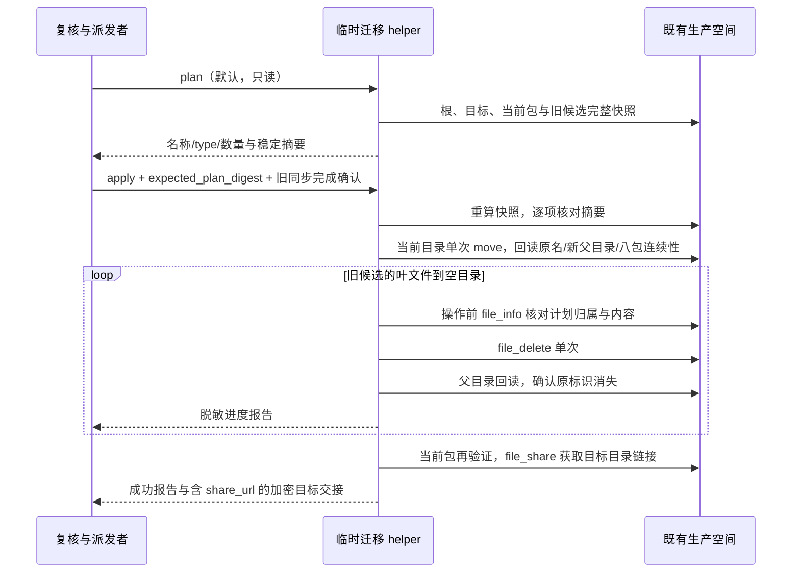

# 一次性发布目录迁移与旧版本清理

仅限临时分支 `codex/wecom-release-relocate-20261105`，基于已冻结的准备提交 `365f4fe8`。A 分支、main、正式 Release、标签和已经排队的任务均不修改。这里只准备离线验证后的代码，实际执行由 root 读取 A inventory 与本阶段 plan 后再派发。

## 固定范围

- 复用既有生产应用、固定代理和空间配置；空间名称必须为「UWork 发布包」，根下唯一类型 1 的「发布包」必须已存在。禁止新建空间、目录、修改 ACL 或更新仓库配置。
- 唯一当前版本为 `v0.1.8`。根目录有该版本且目标无同名/同版本目录时，可整体 `file_move` 到「发布包」，`replace:false`；两处同时存在立即失败，不能接受服务端自动改名。若根已无当前版本且目标存在唯一当前目录，则只核验和保留。
- 当前版本的八个常规安装包由现有 `selectWecomReleaseAssets` 从已公开 `v0.1.8` Release 元数据选择，不下载或重新上传。移动前逐个核对类型、状态、名称、大小及有效 SHA1；移动后回读相同标识、名称、新父目录，以及八份文件大小和 SHA1 一致。当前目录其它内容也必须保持连续。
- 删除候选精确绑定已由 root 复核的 A 实际清单：仅空间根的 `v0.1.2`、`v0.1.5`、`v0.1.6` 三个直接子目录。出现其它旧版本、目标「发布包」内旧版本、授权名称类型冲突或重复时拒绝整个计划，不扩大删除范围。当前、未来、非版本名称和其它根下内容保留。候选内仅普通文件/文件夹可处理；未知类型、循环/重复标识、分页异常或归属不明均拒绝。
- 仅在此临时分支给既有客户端增加 `file_move`、`file_delete`、`file_share` 三个固定操作。移动/删除不做网络重试；分享只获取链接，不调用 `file_setting`、ACL、创建或上传操作。

## plan / apply 所有者和顺序

`MODE` 默认 `plan`，只有读取操作。helper 是唯一计划与执行 owner，复用 A 的目录分页、代理新 Node 子进程和 bootstrap 混合加密，不建立第二条目录/加密写入路径。

内部计划记录空间、父目录、类型、状态、标识、名称、大小、SHA1，以及完整候选子树，按确定顺序计算 SHA256 摘要。公开计划仅含可读名称、类型、数量和摘要，不含内部标识、原始响应、凭据或链接。`apply` 必须重新读取并计算同一清单，且与 `expected_plan_digest` 完全一致；并要求 root 明确确认旧自动同步已经成功完成。任何变化或未确认都必须零写入。

目录删除前必须实际为空；不能依赖未明确保证的服务端递归删除。创建/移动/删除结果不明时只回读，不盲重发；无法确认即停止并保存已完成的可读进度。每个删除前都核对标识、空间、父目录、名称、类型、状态，普通文件同时核对大小和 SHA1，并回查目标目录与候选的完整祖先链，防止计划之后新增/替换内容、祖先搬迁或改名导致删除越界。

只有全部操作和当前版本复验成功后获取 `file_share`，链接只进入原 version 1 RSA-OAEP-SHA256 + AES-256-GCM 加密交接，不打印或隐式改应用主页。临时 workflow 只有固定分支的 `workflow_dispatch`，checkout 固定 `github.sha`，继续复用正式同步 concurrency；本阶段不自动派发、不改变 A 远端分支。

## 聚焦验收

1. plan 仅选择根下已复核的三个旧版本名，排除当前/未来/无关目录；其它旧版本必须拒绝；错误空间、目标冲突、未知候选类型等拒绝且零写入。
2. 任意快照变化导致摘要不匹配，或未确认旧同步完成，apply 均零写入。
3. 合法移动保留当前八包与其它内容；旧目录按叶文件、空目录顺序清理；当前、未来和无关数据全部保留。分享链接仅能从加密交接中取得。
4. 模拟响应丢失或中途失败，验证无盲重试、停止后续破坏性操作且报告 partial；不以环境或网络错误伪装成功。执行聚焦测试、根 typecheck/lint、架构与格式检查，不调用真实 API。

官方接口合同：`file_move` 97884，`file_delete` 97885，`file_share` 97890；不得用 97889 `file_setting` 代替获取链接。
