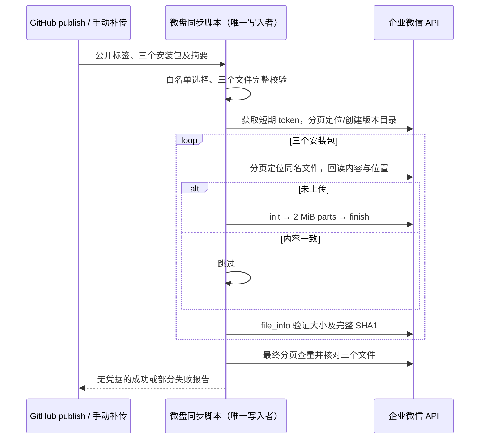

# UWork 企业微信微盘安装包同步

## 产品规则与所有者

- GitHub Release 是标签、安装包与 SHA-256 的唯一来源。复用 GitLab 同步的 `selectGitLabReleaseAssets` 与 `validateLocalAssets`，只上传当前版本的 macOS ARM64 DMG、Windows x64 EXE、Linux amd64 DEB；不上传源码、ZIP、清单或其它架构。
- 新建 `wecom-release-sync.yml`，支持 `release.published` 和指定标签的 `workflow_dispatch`。桌面 publish job 在附件上传、公开 Release 后显式派发；GitLab 与微盘派发独立，前者派发失败不阻止后者尝试。同步失败不撤回 GitHub Release。
- 未配置时，自动发布仍可完成，派发前通过仓库变量 `WECOM_SYNC_ENABLED` 开关启用；手动补传不受开关影响，但缺少配置必须失败并列出变量名，不能显示同步成功。
- 同步脚本唯一拥有目标目录创建、上传与核验。应用凭据获取短期 access_token，仅在进程内缓存/过期刷新；不使用个人 CLI 凭据。目标共享空间及父目录由配置提供，不自行创建空间或修改成员权限。
- 每个标签在目标父目录下使用同名版本子目录。全局 workflow concurrency 串行同步，不能取消正在上传的版本。版本目录和安装包按精确名称分页查找，多个同名或类型冲突时停止。
- 本地三个文件全部通过大小及 GitHub SHA-256 校验后，才可创建目录或上传。按官方 2 MiB 分块合同计算中间 SHA-1 state（小端字节序）和末块完整 SHA-1。初始化支持秒传，分块编号从 1 开始，禁止将普通分块 hash 误用为累积 state。
- 远端已有同名文件必须回读 file_info，验证正常状态、类型、名称、位置、大小及 SHA-1；一致则跳过，不覆盖冲突。每个新上传文件也必须回读验证。最终再次分页检查目录，确认三个安装包各恰好一个；部分成功保留供补传。
- GET/只读请求、分块请求可以对网络错误、超时、HTTP 429/5xx、企微系统繁忙/限频做有限指数重试。创建目录、上传初始化与完成提交遇到结果不明时，先重新查询目标；发现已完成且校验一致则继续，否则以失败结束，后续手动补传重新初始化，不能盲目重发导致重复文件。
- token 失效错误可刷新一次后重试。鉴权、权限和参数错误立即失败，不打印凭据、请求 URL、上传凭证或接口原始错误文本。失败报告只包含标签、文件名、校验结果与安全错误说明。

## 接口与事件顺序

配置：Secrets `WECOM_CORP_ID`、`WECOM_SECRET`；`WECOM_SPACE_ID`、`WECOM_FOLDER_ID`（省略时为空间根目录）、`WECOM_SYNC_ENABLED`（自动派发开关）兼容 Variables 与 Secrets，同名 Variable 非空时优先，不要求迁移已配置的 Secret。可选 `WECOM_SYNC_RUNNER` 保留为 Variable。开关经步骤环境读取，只输出固定的 yes/no 控制结果，不把 Secret 放入 job/step 的 if 表达式，也不把其原值传入 job output。桌面派发步骤同样在环境中判定开关；未启用时正常退出。运行时输入 `RELEASE_TAG`、`RELEASE_JSON`、`ASSET_DIR`、`SYNC_REPORT`。重试次数固定最多 4 次，每次请求 60 秒超时。

## 验收与边界

1. 缺失/重复安装包、草稿、标签错配、文件损坏在任何微盘写入前失败。
2. 官方 demo 的 5,999,998 字节样本三个累积摘要一致；覆盖小文件、恰好 2 MiB、跨块与多块末尾。
3. 空目录上传恰好三份；再次执行零上传；部分失败后补传只补缺少文件；分页后的同名文件不得漏检。
4. token 刷新、分块临时失败、429/5xx、系统限频可恢复；权限失败不重试；重试耗尽失败。
5. 目录创建/完成提交响应丢失时，查询已提交结果并验证，避免盲目重发；远端同名冲突/伪成功/大小或 SHA 错误必须失败。
6. workflow 合同覆盖自动事件、手动标签、显式派发、串行、失败报告、三个文件白名单和下载重试。执行聚焦 Node 测试、根 typecheck、lint、架构检查。没有企业配置时只报告本地验证，不声称已完成真实上传验收。
7. 目录和启用开关全部配置在 Secrets 时，预检、上传和自动派发仍可正确读取；未配置/false 时不自动派发，手动补传仍可执行。日志和跨 job output 不包含这些配置原值。

## 官方依据

- [上传文件](https://developer.work.weixin.qq.com/document/path/97880)：普通上传上限 10M。
- [文件分块上传](https://developer.work.weixin.qq.com/document/path/98004)：2 MiB、累积 SHA、最大 20G、init/part/finish。
- [获取文件列表](https://developer.work.weixin.qq.com/document/path/93657)、[新建文件夹](https://developer.work.weixin.qq.com/document/path/97882)、[获取文件信息](https://developer.work.weixin.qq.com/document/path/97886)。
- [企业微信官方摘要示例](https://github.com/wecomopen/file_block_digest/tree/main/demo)。
