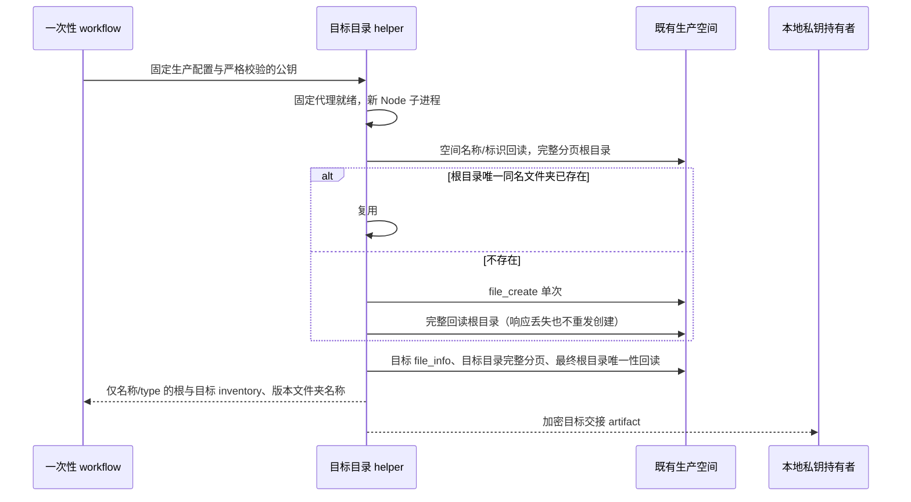

# 一次性微盘发布目标目录准备

用户已指定既有空间「UWork 发布包」内的「发布包」为发布目标。本分支仅准备、测试一次性操作代码；未经复核不提交、推送或派发，且不进入 main。

## 范围和所有者

- 生产应用、固定代理与现有空间继续来自仓库生产 Secrets/Variables。不能通过 workflow 输入换应用、空间或目录名，不使用个人 CLI，不创建空间或修改 ACL。
- 一次性 helper 是本次目录创建的唯一写入者，只允许 `new_space_info`、分页 `file_list`、目标目录 `file_info`，以及最多一次 `file_create`（类型 1，名称固定为「发布包」，父目录为空间根）。不上传、移动、删除文件或版本目录，也不修改仓库配置、发布源或标签。
- 临时 workflow 只有 `workflow_dispatch`，限 `codex/wecom-target-directory-20261105` 分支；使用与正式同步相同的 concurrency group，等待正在运行的同步结束。输入仅 `public_key`，为 Base64 PEM RSA 公钥，严格解码并在任何远端请求前验证至少 2048 位。私钥仅留本地。
- 代理包装器拥有子进程与临时配置生命周期；helper 只在开启 Node 环境代理的新子进程内调用 API。缺少固定代理或代理失败即停止，不回退直连。
- 复用 bootstrap 的单一混合加密实现：随机 AES-256-GCM 加密目标 JSON，RSA-OAEP-SHA256 封装随机密钥，保持 version 1 envelope。只加密交接 `{space, folder, name: 'UWork 发布包/发布包'}`，不输出内部标识、凭据、原始错误或响应正文。

## 顺序与失败处理

空间名称必须精确为「UWork 发布包」；使用该既有空间回读的 API 标识。根目录同名重复、同名非文件夹、不可确认状态、分页不前进/重复标识、创建与回读标识冲突、目标父目录/空间/类型/名称不一致均失败。创建响应丢失后只查一次完整目录快照，未确认则停止，后续重跑仍先查唯一同名目录。

报告中的目录项只保留可读 `name` 和数字 `type`（1 为文件夹）；版本列表只枚举正式版本名，不执行清理，包含当前版本供后续核对。全部回读成功后才保存权限 0600 的加密交接文件；临时 artifact 保留 1 天。

## 验收

- 空根目录创建一次并回读；已有目录零创建；创建响应丢失但回读一致可恢复；创建结果未确认、同名冲突、元数据不一致立即失败，不重发创建。
- 覆盖完整分页、游标不前进、重复标识和返回格式错误。任何场景都不能出现空间创建、ACL、删除、移动或上传请求。
- 使用真实 RSA/AES 往返解密确认 space/folder 分离且 envelope 与 bootstrap 一致。无效 Base64、无效 PEM、弱 RSA 和错误算法须零远端请求；报告与错误不含测试凭据或内部标识。
- workflow 合同只允许手动固定分支、固定生产配置、同一串行组和公开公钥输入；不会恢复正式同步或更新仓库 Secrets/Variables。根 typecheck、lint、架构及聚焦 Node 测试记录真实结果。
