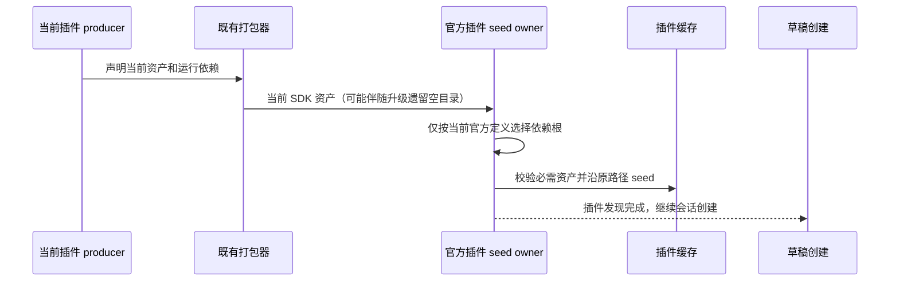

# Windows 升级后的草稿创建与官方插件依赖根

## 问题和证据

用户从旧版升级至 0.1.8 后，首发显示通用的草稿会话创建失败提示。现场日志的直接异常是官方 Computer Use 插件的 `node_modules/koffi/package.json` 不存在；没有 SQLite 锁错误，模型与 Agent 已就绪。具体升级前版本尚未确认，不能据此归因某一次数据库迁移。

当前 `@zcode/zcode-cua-plugin` 0.6.5 producer 只声明 `@zcode/zcode-cua`，不声明 Sharp 或 Koffi；桌面打包器也在未声明时跳过对应 staging。升级目录仍可能保留旧版本留下的空 `node_modules/sharp`、`node_modules/koffi`。原官方插件定义继续将两者列作运行依赖根，目录存在就读取其清单，因而在插件发现阶段抛出 ENOENT。草稿路径会调用同一发现入口；隔离复现中，这个异常发生在会话数据库初始化之前，不能据此推定 Host 组织库曾被锁定。

## 产品规则和所有者

- 官方插件定义必须与当前 producer、打包器的运行依赖合同一致。Computer Use 当前没有额外的 Sharp/Koffi seed 根，历史目录存在不能使其重新成为当前依赖。
- 官方插件缓存仍由现有 `bundled-plugins` seed 路径唯一管理；继续校验 SDK 必需资产，不新增依赖回退、安装器清理或另一条写入路径。
- 通用依赖收集器的严格规则保持：显式声明的运行根存在但清单损坏时仍报错；必需传递依赖缺失或非法目录穿越仍拒绝。不能把任意缺失的 `package.json` 当成可忽略错误。
- 不恢复废弃的原生依赖，不改 SQLite、会话状态、插件启用状态或草稿重试策略。此修复面向所有桌面平台，Windows 升级是已报告的触发场景。

## 验收

1. 真实临时 producer 布局分别保留空 Sharp、空 Koffi 目录时，官方 seed 成功，SDK 资产进入缓存，旧依赖不被复制。
2. 同一布局通过普通 `resolveZCodePlugins` 入口完成插件发现，不能在草稿使用的发现链路抛 ENOENT。
3. 显式构造带原生依赖的测试定义，继续验证依赖闭包、缺失必需传递依赖以及目录穿越拒绝规则，恢复测试定义后不影响真实默认合同。
4. 原版先在新增回归中失败，移除过时定义后通过；执行相关 CLI 测试、根与 CLI 类型/Lint、架构及改动格式检查。Windows 原版/修后运行验证由根任务记录，不把本机单测等同于 Windows 实机验收。
